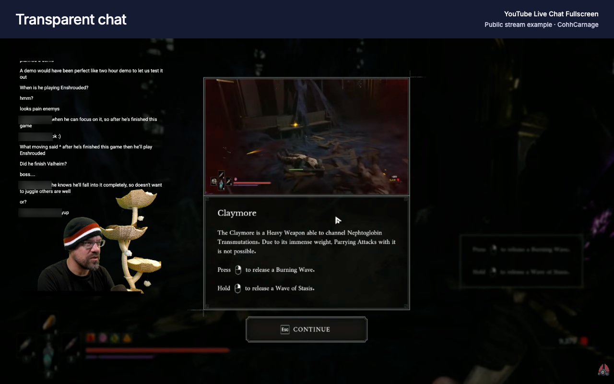

  

<h1 align="center">YouTube Live Chat Fullscreen</h1>

  <strong>Watch in fullscreen. Keep the chat.</strong> 
  Enjoy the stream and the reactions together. Move, resize, and style YouTube's own chat over the video.

  Chrome &amp; Firefox · Live &amp; replay · 55 interface locales · Free &amp; open source

  <a href="https://chromewebstore.google.com/detail/youtube-live-chat-fullscr/dlnjcbkmomenmieechnmgglgcljhoepd"><strong>Install on Chrome</strong></a>
  ·
  <a href="https://addons.mozilla.org/firefox/addon/youtube-live-chat-fullscreen/"><strong>Install on Firefox</strong></a>
  ·
  <a href="docs/user-guide.md">User guide</a>
  ·
  <a href="docs/translations/README.ja.md">日本語</a>
  ·
  <a href="docs/translations/README.zh-TW.md">繁體中文</a>

*Default chat with the native input visible; the draft was not sent. Viewer identities are blurred for the screenshot. Footage: Kazama Iroha / hololive. [Sources and privacy](docs/store-assets/chrome-web-store/README.md#sources-and-privacy).*

## Keep up with the conversation

A boss fight, a live performance, a moment everyone reacts to: keep the video fullscreen and the conversation in view. On an archive with playable chat replay, you can watch the original reactions alongside the recording.

The overlay uses YouTube's own chat. During live streams, you can read and reply without leaving fullscreen; sign-in, posting, badges, and Super Chat still follow YouTube's rules and the channel's participation settings.

## Make room for your stream

Choose a layout that fits what you are watching. Appearance and placement changes are saved automatically.

| What you want to do | What you can adjust |
| --- | --- |
| Keep the game or performer in view | Drag chat to another part of the frame and resize it from an edge or corner |
| See the video behind the conversation | Set the background color, opacity, and blur |
| Read chat from your viewing distance | Change text size, font, colors, and message spacing |
| Focus on the messages | Hide ordinary-message usernames and avatars |
| Keep reactions visible after controls fade | Leave chat visible while idle, with an optional messages-only layout |
| Switch between reading styles | Save named presets; export settings as JSON to back them up or move browsers |

*A fully transparent, messages-only replay layout keeps the game in view. This archive example has no message input. Footage: CohhCarnage. [Sources and privacy](docs/store-assets/chrome-web-store/README.md#sources-and-privacy).*

Light, dark, and system themes are available, with 55 interface locales and right-to-left layouts. The [user guide](docs/user-guide.md) offers preset starting points and explains the controls.

## Start watching

1. Install from the [Chrome Web Store](https://chromewebstore.google.com/detail/youtube-live-chat-fullscr/dlnjcbkmomenmieechnmgglgcljhoepd) or [Firefox Add-ons](https://addons.mozilla.org/firefox/addon/youtube-live-chat-fullscreen/).
2. Open a YouTube live stream or an archive with playable chat replay, then enter fullscreen. Chat is enabled by default.
3. Hover the panel to open its controls. Drag its move handle to reposition it, resize from its edges, or open settings to change the appearance. The chat button in the player controls toggles visibility.

The extension is for desktop browsers. The Chrome build also runs in Opera. Videos without usable chat keep the normal fullscreen player without an overlay.

See the [user guide](docs/user-guide.md) for presets and backups, or [troubleshooting](docs/troubleshooting.md) if the panel does not appear.

## Privacy you can inspect

There is no extension account, analytics SDK, or tracking service. Settings stay in this browser's `browser.storage.local`; the extension does not send viewing activity or chat content to the developer. YouTube's own chat continues to communicate with YouTube.

The production manifest requests only `storage`, and content scripts and public extension resources are scoped to YouTube. Optional font selections may fetch fonts from Google Fonts. The [package policy](config/packagePolicy.ts) and [package checks](scripts/verify/check-package-contracts.mjs) make these boundaries visible in the source.

## Explore the engineering

This is a WXT, React, TypeScript, Jotai, and Tailwind CSS extension for Chrome and Firefox. Its small interface connects to some practical browser problems:

- [Follow YouTube navigation](docs/architecture/content-runtime.md): borrow the native chat iframe, keep it working across video changes, and return it when fullscreen ends.
- [Preview styles while editing](docs/architecture/settings-and-state.md): update the chat during a slider gesture while keeping drafts, saved settings, and changes from other extension windows in order.
- [Reproduce browser behavior locally](docs/testing/contracts.md): exercise live, replay, and no-chat scenarios with deterministic YouTube fixtures, then check real-site compatibility separately.

The [engineering overview](docs/engineering.md) connects those behaviors to the code. The [contribution guide](CONTRIBUTING.md) includes small examples you can run before choosing a change.

## Help shape the extension

You can help by describing a viewing problem, improving a translation, clarifying a guide, or making a focused fix. You do not need to understand the entire runtime to contribute; [choose a starting point](CONTRIBUTING.md#choose-a-starting-point).

- [Report a bug](https://github.com/daichan132/Youtube-Live-Chat-Fullscreen/issues/new?template=bug.yml) or [suggest a feature](https://github.com/daichan132/Youtube-Live-Chat-Fullscreen/issues/new?template=feature.yml).
- Follow [SECURITY.md](SECURITY.md) for private vulnerability reports.

Licensed under [GPL-3.0](LICENSE).
