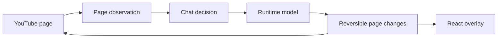

# Engineering YouTube Live Chat Fullscreen

The extension overlays YouTube's own chat on the fullscreen player. The main engineering challenge is returning that chat intact when YouTube replaces the player, changes video without reloading, or switches between live and replay.

WXT handles extension builds and browser integration. React renders the interface, Jotai holds each context's state, TypeScript describes runtime and settings models, and Tailwind CSS styles the extension UI. There is no background service worker.

For local setup and verification, start with [Contributing](../CONTRIBUTING.md).

## Entrypoints

| Entrypoint | Responsibility |
| --- | --- |
| [Content script](../entrypoints/content/index.tsx) | Starts and disposes sessions on supported YouTube video pages |
| [Toolbar popup](../entrypoints/popup/main.tsx) | Provides the extension's popup controls |
| [Settings page](../entrypoints/settings/main.tsx) | Renders `settings.html` inside an extension iframe over the player |

## Content lifecycle

The content runtime observes YouTube, decides whether chat is usable, and applies reversible page changes:

Read the implementation in this order:

1. [ContentBootstrap](../entrypoints/content/bootstrap/ContentBootstrap.ts) accepts `/watch`, direct `/live/<videoId>`, and channel `/live` entries.
2. [createContentSession](../entrypoints/content/bootstrap/createContentSession.tsx) and [SessionScope](../entrypoints/content/bootstrap/SessionScope.ts) own one React/runtime session and its cleanup.
3. The [YouTube adapter](../entrypoints/content/platform/youtube/) collects page evidence and DOM targets. Compatibility selectors belong in its `selectorCatalog.ts`.
4. [resolveChatDecision](../entrypoints/content/runtime/resolveChatDecision.ts) and [runtimeModel](../entrypoints/content/runtime/runtimeModel.ts) turn that evidence into a plan without changing the DOM.
5. [ChatRuntime](../entrypoints/content/runtime/ChatRuntime.ts), [ResourceReconciler](../entrypoints/content/runtime/ResourceReconciler.ts), and [resource leases](../entrypoints/content/runtime/resources/) apply the plan and reverse their changes on release.

A generation identifies the current video, player, and fullscreen root. Deferred work from an older generation cannot change the new page. Borrowed chat iframes are restored before another is acquired; extension-created iframes are removed. Retry and recovery attempts are bounded.

Live streams prefer native live chat and can fall back to an extension-created live iframe. Archives require a playable native replay iframe. Videos without usable chat keep the normal player without an overlay.

Route handling, source selection, restoration, and failure behavior are detailed in [Content runtime](architecture/content-runtime.md).

## Settings and presentation

The popup, content script, and settings page have independent stores. They share committed preferences through `browser.storage.local`, split into enabled, theme, appearance, geometry, and locale domains. Writes in one domain do not carry stale values from another. Conflicting writes within one domain use last-write-wins.

The settings iframe sends transient style previews through `window.postMessage`. Both directions check the expected window, exact origin, and payload schema. The YouTube parent origin must equal `https://www.youtube.com`; wildcard target origins are not used. Committed preferences still converge through Storage.

Choose the guide for the area you are changing:

- [Settings and state](architecture/settings-and-state.md): startup compatibility, write ordering, backups, and save failures.
- [Overlay and iframe styling](architecture/overlay-and-styling.md): panel geometry, interactions, CSS ownership, and restoration.
- [Internationalization](architecture/i18n.md): authored translations, generated assets, and language loading.

## Verification and release

Run `yarn verify` for code, configuration, or dependency changes. Additional browser and package checks depend on the change; [Testing contracts](testing/contracts.md) explains which checks to run and where new tests belong.

Production packages request only `storage`, scope public resources to YouTube, and exclude testing bridges and fixtures. Package checks enforce those rules. Diagnostic reports exclude URLs, video IDs, chat text, usernames, and other user-specific content.

Release candidates and store submission use separate manual workflows. Publication verifies the candidate's hashes and submits the same ZIPs without rebuilding. See the [maintainer guide](maintainers/README.md) for real-browser verification and release procedures.
