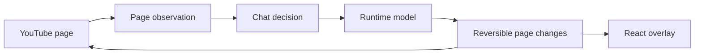

# Engineering YouTube Live Chat Fullscreen

The extension overlays YouTube's own chat on the fullscreen player. The main engineering challenge is returning that chat intact when YouTube replaces the player, changes video without reloading, or switches between live and replay.

WXT handles extension builds and browser integration. React renders the interface, Jotai holds each context's state, TypeScript describes runtime and settings models, and Tailwind CSS styles the extension UI. A small background handler serves allowlisted packaged locale and stylesheet assets; page and chat state stay in their owning contexts.

For local setup and verification, start with [Contributing](../CONTRIBUTING.md).

## Entrypoints

| Entrypoint | Responsibility |
| --- | --- |
| [Content script](../entrypoints/content/index.tsx) | Starts and disposes sessions on supported YouTube video pages |
| [Toolbar popup](../entrypoints/popup/main.tsx) | Provides the extension's popup controls |
| [Settings page](../entrypoints/settings/main.tsx) | Renders `settings.html` inside an extension iframe over the player |

## Content lifecycle

The content runtime observes YouTube, decides whether chat is usable, and applies reversible page changes:

Read the implementation in this order:

1. [ContentBootstrap](../entrypoints/content/bootstrap/ContentBootstrap.ts) accepts `/watch`, direct `/live/<videoId>`, and channel `/live` entries.
2. [createContentSession](../entrypoints/content/bootstrap/createContentSession.tsx) and [SessionScope](../entrypoints/content/bootstrap/SessionScope.ts) own one React/runtime session and its cleanup.
3. The [YouTube adapter](../entrypoints/content/platform/youtube/) collects page evidence and DOM targets. Compatibility selectors belong in its `selectorCatalog.ts`.
4. [resolveChatDecision](../entrypoints/content/runtime/resolveChatDecision.ts) and [runtimeModel](../entrypoints/content/runtime/runtimeModel.ts) turn that evidence into a plan without changing the DOM.
5. [ChatRuntime](../entrypoints/content/runtime/ChatRuntime.ts), [ResourceReconciler](../entrypoints/content/runtime/ResourceReconciler.ts), and [resource leases](../entrypoints/content/runtime/resources/) apply the plan and reverse their changes on release.

A generation identifies the current video, player, and fullscreen root. Deferred work from an older generation cannot change the new page. Borrowed chat iframes are restored before another is acquired; extension-created iframes are removed. Retry and recovery attempts are bounded.

Returning the same iframe matters because its URL can lag behind its live state. YouTube can change videos without replacing the chat document or updating the iframe's continuation URL. Reloading that URL while moving the chat could bring back an earlier video's chat. The [browsing-context scenario](../e2e/scenarios/live/iframeContextPreservation.fixture.spec.ts) exercises this case through repeated fullscreen entry and exit, checking that the current document and runtime state survive.

Live streams prefer native live chat and can fall back to an extension-created live iframe. Archives require a playable native replay iframe. Videos without usable chat keep the normal player without an overlay.

Route handling, source selection, restoration, and failure behavior are detailed in [Content runtime](architecture/content-runtime.md).

## Settings and presentation

The popup, content script, and settings page have independent stores. They share committed preferences through `browser.storage.local`, split into enabled, theme, appearance, geometry, and locale domains. Writes in one domain do not carry stale values from another. Conflicting writes within one domain use last-write-wins.

The settings iframe sends transient style previews through `window.postMessage`. The receiver checks the expected window, exact origin, and payload schema. The YouTube parent origin must equal `https://www.youtube.com`; wildcard target origins are not used. Committed preferences still converge through Storage.

The extension's manifest CSP restricts every frame ancestor to the extension itself or exact `https://www.youtube.com`. This protects the storage-writing settings UI from embedding by unrelated sites, including Firefox MV2 where the resource list cannot scope a public resource to one origin. An allowed YouTube iframe inside a hostile top-level page does not bypass this restriction. Only packaged scripts are permitted and embedded objects are disabled.

This separation lets a color or size slider update the chat while it is being dragged, then save once when the gesture finishes. Save ordering also affects what the viewer sees: an earlier gesture's delayed save must not make the next preview snap back. [`SettingsFrame.tsx`](../entrypoints/content/settings/SettingsFrame.tsx) retains the final preview until its matching committed value arrives.

Choose the guide for the area you are changing:

- [Settings and state](architecture/settings-and-state.md): startup compatibility, write ordering, backups, and save failures.
- [Overlay and iframe styling](architecture/overlay-and-styling.md): panel geometry, interactions, CSS ownership, and restoration.
- [Internationalization](architecture/i18n.md): authored translations, generated assets, and language loading.

## Browser scenarios

The deterministic scenarios run the extension against synthetic YouTube pages. You can reproduce a fullscreen transition without finding a live stream or depending on today's YouTube layout. For example, [archive restoration](../e2e/scenarios/archive/borrowRestore.fixture.spec.ts) checks the borrowed iframe's original position and styles, while [channel live entries](../e2e/scenarios/live/channelLiveEntry.fixture.spec.ts) exercise video changes on the same page URL.

The [typed scenario tools](../e2e/support/youtubeScenario/) keep page construction separate from each test's actions and assertions. See [Contributing](../CONTRIBUTING.md#try-a-focused-test) for a single-scenario command. Real-YouTube canaries separately check compatibility with the current site.

## Verification and release

Run `yarn verify` for code, configuration, or dependency changes. Additional browser and package checks depend on the change; [Testing contracts](testing/contracts.md) explains which checks to run and where new tests belong.

Production packages request only `storage`, inject content scripts only on `https://www.youtube.com/*`, and exclude testing bridges and fixtures. Chrome scopes public resources to the same HTTPS origin; Firefox MV2 exposes only the settings page through its resource list. Package checks enforce those rules and the exact extension-page CSP in both manifest formats. After building the production Chrome extension, `node scripts/verify/settings-embedding.browser-test.mjs` checks normal YouTube embedding and rejects an allowed immediate parent under a hostile ancestor without external network access. Diagnostic reports exclude URLs, video IDs, chat text, usernames, and other user-specific content.

Release candidates and store submission use separate manual workflows. Publication verifies the candidate's hashes and submits the same ZIPs without rebuilding. See the [maintainer guide](maintainers/README.md) for real-browser verification and release procedures.
