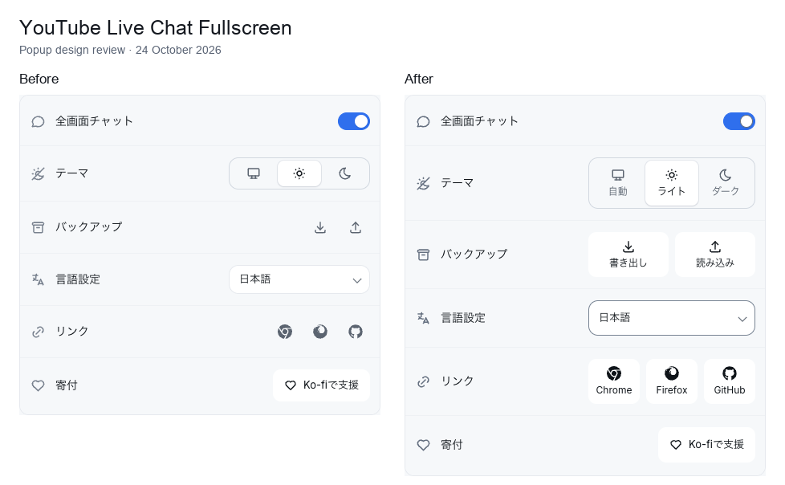
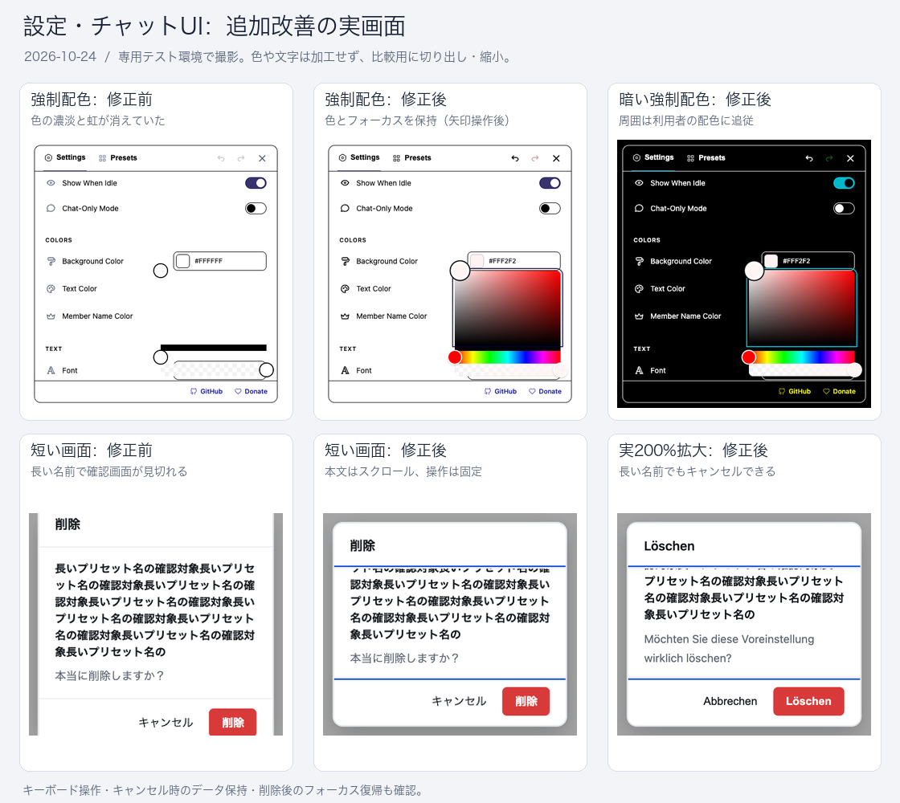
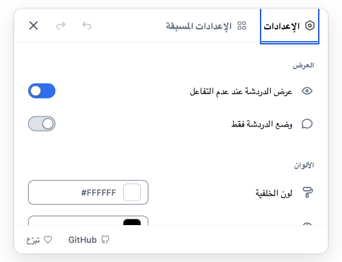

# 設定・チャットUIの改善と検証記録

2026-10-24〜25 JST。UI実装の最終コミットは `f94803b2`、自然なFirefox遅延の記録ツールは `7cc8d41f`。この記録の追加は文書・画像のみで、検証したUI実装を変更しない。

## 改善内容

[デジタル庁のアクセシビリティ指針](https://design.digital.go.jp/dads/guidance/accessibility/)と[Apple Human Interface Guidelines](https://developer.apple.com/design/human-interface-guidelines/accessibility)を参照し、可読性、キーボード操作、表示環境への適応を改善した。包括的な規格適合の認証ではない。

- 設定・popupのコントラスト、キーボードフォーカス、可視ラベル、44pxタッチ操作領域、320px幅での配置を改善。
- 強制配色で色選択の色面とグラデーションを保持。周囲のUIとフォーカスはシステム色に追従。
- フォント検索0件時の空listboxと不正なARIA参照を除去し、検索修正・選択・Undoを維持。
- 小さい画面・200%拡大・長い名前でもプリセット削除確認を操作でき、削除後のフォーカスを復帰。
- ヘルプをEscapeで非表示にでき、トリガーから説明へホバー移動できるよう修正。iframe内のキー入力とイベント後始末も確認。
- 配置パネルからTab移動すると閉じ、移動先のフォーカスを維持。RTLの方向と数値、文書のlang/dir、色選択ライブラリのラベル言語、アラビア語の配置・閉じる操作を改善。
- popupのテーマ・バックアップ操作・リンク先を明確化し、インポート確認、保存失敗時の再試行、リカバリー操作を改善。
- 未使用CSSを162行削除し、本番ZIPの既存容量制限を維持。設計契約と画像ベースラインを更新。

## 実行した検証

- `7cc8d41f`の`yarn verify`: core/DOM 1,189件、contracts 286件成功。既存のCSS specificity警告3件は残る。
- UI実装後のChromeブラウザ検証249件成功（fixture 224、visual 4、accessibility 21）。最終CSS整理・翻訳修正後の関連検証57件成功（fixture 32、visual 4、accessibility 21）。両実行には重複がある。
- UI最終版の`yarn test:package`: Chrome・Firefox・source ZIP契約成功。同じ最終Chrome ZIPでブリッジなし起動smoke 1件、実YouTube canary 5件（ライブ・アーカイブ・遷移・チャットなし）成功。
- 上記最終ブラウザ実行の失敗・skip・retryは0。途中の開発用失敗を含めて一度も失敗しなかったという意味ではない。
- 55言語×4幅のpopup 220状態、55言語の320px settings、220ポップオーバーを実測。macOSのvisual 4件に加えUbuntu 24.04/x64のpopup明暗画像も生成して確認。
- ヘルプ表示中のreload・iframe置換を各6回、計12回実施し、現在の文書でリスナーの累積なし。非表示・全画面終了で基準に復帰。破棄された旧文書のリスナー削除数自体は直接測定していない。
- UI検証後の追加変更は任意のFirefox記録ツールとそのテスト・手順書のみで、拡張実行コードは変更していない。source ZIP再構築の`yarn verify:firefox-source`は今回の実行結果として主張しない。

## Firefoxでの確認と限界

Firefox 158の専用一時プロファイルで、設定・popupの明暗、強制配色、実200%拡大、アラビア語RTL、フォント検索・選択、色選択、プリセット削除・キャンセル・フォーカス復帰、全画面配置パネルのドラッグ・サイズ・復元・閉じる操作を確認した。初回全画面のライブ・アーカイブはnative CSS 14,945規則と実画像を確認し、Gecko AXと実Tab/Space/矢印/Enter/Escape操作も確認した。VoiceOverの音声読み上げは未検証。検証は消音で行った。

最終Firefox ZIPは専用コピー・新規プロファイルで読み込み、全127ファイルおよび読み込んだ設定JS/CSS・content scriptの一致を確認。追加の全画面終了26回（拡張あり19、なし7）は全回復帰した。

一度観測した約8.752秒のrenderer生成待ちは原因未確定。Lottie取得を8秒保留する切り分けでは、拡張なし約8.421秒・あり約8.443秒となったが、元の自然な遅延と同じ原因だった証明ではない。借用iframeの所有・復元処理は今回変更していない。

その後、通信を変更しない自然条件で40回＋最終確認1回＋追加70回を観測し、111回全て489〜1,364msで復帰。約9秒の待ちは再現しなかった。最終70回は約10分、中央値553.5ms、通信53,814イベント。元のiframe/親・renderer・native CSS・拡張スタイル解除を測った値であり、ピクセルによる描画完了時間ではない。

[`record-firefox-chat-delay.mjs`](../../../../scripts/verify/record-firefox-chat-delay.mjs)は5秒超で保留通信を保存し、復帰まで追跡する任意の検証コマンド。URL・動画ID・ヘッダー・Cookie・本文・ユーザー名を保存せず、通信種別・匿名番号・時刻・状態コードを保存する。新規一時プロファイル、起動前の音量ゼロ・自動再生禁止・更新抑止、専用Firefoxのnormal quitとプロファイル削除を確認した。通信記録の観測負荷はあり得る。遅延調査は終了済みで、原因未確定のまま修正済みとは扱わない。[実行手順](../../verification-browser.md#firefox-の自然なチャット生成待ちの通信記録)を参照。

## 比較画像

実ブラウザ画面の切り出し・縮小。色や文字は描き直していない。拡張の設定画面だけを掲載し、公開チャットの本文・利用者名は含めていない。

### Popupの操作ラベル（左:変更前、右:変更後）

### 強制配色の明暗・削除確認・200%拡大

### Firefox・アラビア語RTL・200%拡大

