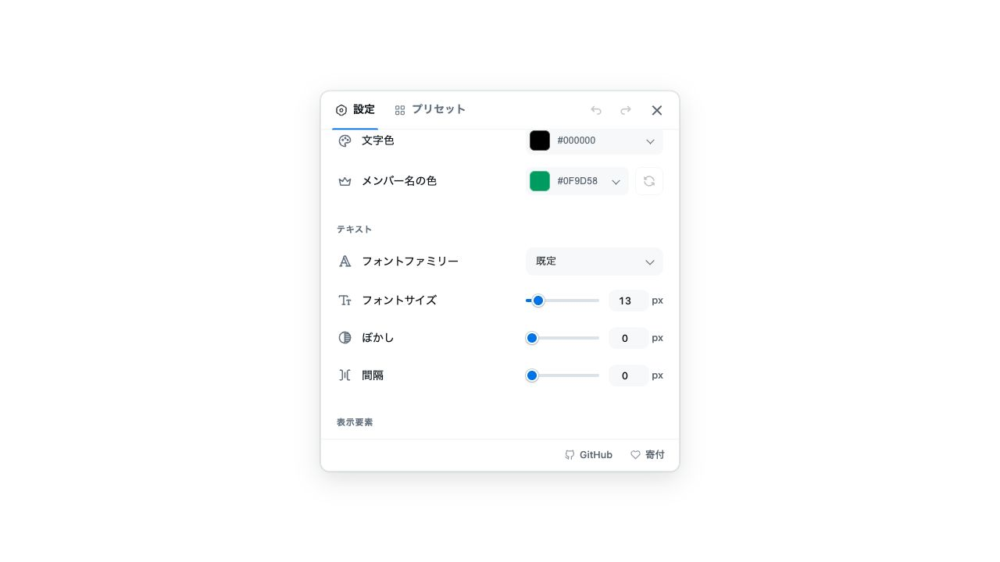
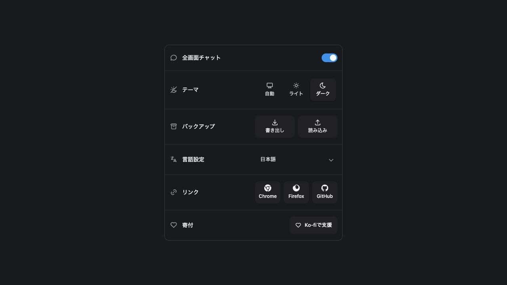
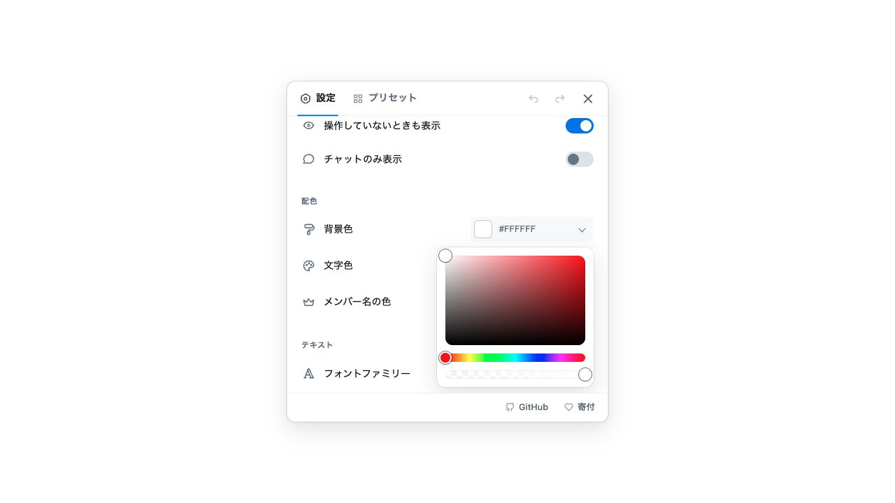
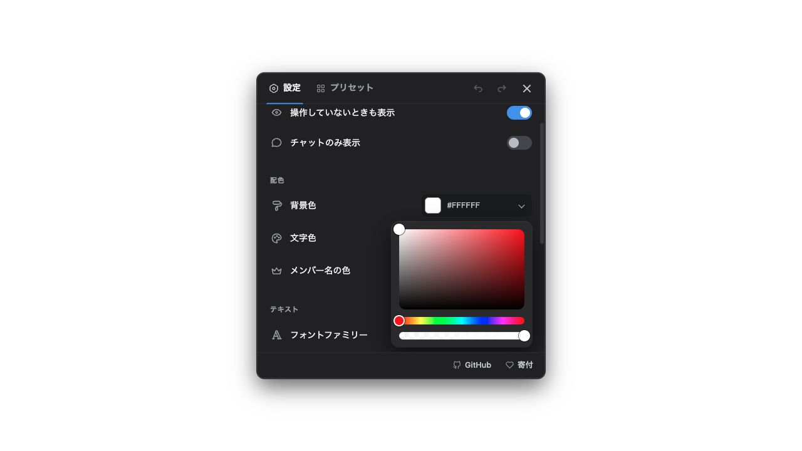

# 設定・チャットUIの改善と検証記録

2026-10-24〜25 JST。共通UI全体の検証コードは `c3edb66d`。後続のカラーピッカー追加調整は末尾に別記する。

## デザインの統一方針

[デジタル庁のアクセシビリティ指針](https://design.digital.go.jp/dads/guidance/accessibility/)と[Apple HIG](https://developer.apple.com/design/human-interface-guidelines/accessibility)を参照。包括的な規格適合の認証ではない。

- 色・フォント・数値・検索・選択欄は共通の淡い操作面を使い、通常時の濃い囲み枠をなくす。数値入力のinlineスタイルは共通CSSへ移した。値と開閉矢印で操作を伝え、hoverは面の濃度で示す。
- トグルは二重の輪郭と光沢を減らしたフラットなトラックにし、つまみの位置・明暗・アクセント色で状態を区別。スライダーの余分なトラック外枠も除去。
- テーマ切替は塗りのグループと軽く浮いた選択面に整理。キーボードフォーカスの明瞭な輪郭は全体で維持し、強制配色ではシステム色の境界を復帰する。
- プリセットは1行54pxのコンパクトな配置を維持。名前の1行編集を保ち、保存名全文をtitleでも確認できる。適用中は淡い背景と丸いチェック付きラベル。狭いタッチ画面だけ操作を折り返して44pxの操作領域を確保。
- 削除確認は見出しと本文を視覚的にまとめ、余分な区切り線を除去。本文とボタンの間は実測12px、footer下は16pxを維持。長い本文だけをスクロールでき、操作は常に表示する。日本語・英語では一覧からの削除と現在の設定が変わらないことを説明する。

トグルのつまみ、開閉矢印、キーボードフォーカスは3:1以上、表示値・ラベルは4.5:1以上を実画面の色で確認。操作面の枠そのものを必須の識別手掛かりにしていない。通常のオン/オフ、数値の編集・保存・Undoなどの操作方法は維持した。

## 併せて修正した操作性

- 強制配色でカラーピッカーの色面とグラデーションを保持。
- フォント検索0件時の空listboxと不正なARIA参照を除去し、検索修正・選択・Undoを維持。
- 小画面・200%拡大・長い名前でも削除確認を操作でき、キャンセル時のデータ保持と削除後のフォーカスを維持。
- ヘルプのEscape非表示、トリガーから説明へのホバー移動、iframe内のキー入力とリスナー後始末を修正。配置パネルからTab移動した際の移動先フォーカスを維持。
- 文書のlang/dir、ライブラリ内ラベルの言語宣言、アラビア語の配置・閉じる操作を改善。
- popupのテーマ・バックアップ・リンク先の操作ラベルを明確化し、保存失敗時のRetryとリカバリー操作を改善。
- 任意のFirefox自然遅延記録ツールを追加し、未借用のiframeを復帰成功に数えないよう修正。fixture画像はtestInfo.outputPathで保存する。

## 共通UI全体の検証（c3edb66d）

- `yarn verify`: core/DOM 1,189件、contracts 289件成功。CSS specificity警告4件は残る。
- Chromeの全fixture 224件＋accessibility 25件＝249件成功。日本語・ドイツ語200%・アラビア語RTL、320px幅、タッチ、強制配色、直接数値編集、Undo、ドラッグ、設定の同期、ライブ・アーカイブ・no-chat・SPAの決定的シナリオを含む。
- macOS visual 4件成功。最終の上記ブラウザ実行は失敗・skip・retry 0。途中に表示色を測る対象と非同期描画の待ち合わせを修正しており、開発中から一度も失敗しなかったという意味ではない。
- `yarn test:package`: Chrome・Firefox・source ZIP契約成功。Chrome 379,632 bytes、Firefox 379,683 bytesで、既存380,000 bytes上限を維持。今回使わなくなった装飾トークンを削除して収めた。
- 同じChrome production ZIPのブリッジなし起動smoke 1件成功。
- [Ubuntu 24.04 CI run 40125237727](https://github.com/daichan132/Youtube-Live-Chat-Fullscreen/actions/runs/40125237727): quality、package、production smoke成功。fixture224件、accessibility25件成功。visualはoverlay2件成功、変更したpopup明暗2件が旧画像と不一致。Linuxで生成されたactual画像を確認し、その実画像を新基準へコピーした。macOS画像をLinux基準に転用していない。
- Ubuntuのpopup画像は450px幅でラベル・アイコン・操作が欠けず、今回のトグル・テーマ・選択欄の変更が反映されていることを確認。更新基準とCI actualのファイルはバイト単位で一致。

## Firefoxの確認と未確定事項

専用Firefox158コピーと新規一時profileで、今回の本番ビルドの明暗表示を実画像で確認。数値を実キーで20へ編集してsliderと同期し、Spaceでトグルが反転することを確認。数値入力の枠は透明、トグルの枠は0pxで、共有スタイルが実際に読み込まれている。起動前から音量0・自動再生禁止・更新処理抑止を設定し、normal quitと一時profile削除を確認。通常のFirefox/profileは操作していない。

以前のUI最終版 `f94803b2` では、Chromeの実YouTube canary5件（ライブ・アーカイブ・遷移・no-chat）、Firefox初回全画面のnative CSS14,945規則と実画像、Gecko AXと実入力も確認した。今回の共有スタイル調整後に実YouTube canaryは再実行していない。借用iframeの所有・復元処理は今回変更していない。VoiceOver音声読み上げは未検証。

元の約8.752秒のrenderer生成待ちは原因未確定。人工的なLottie取得保留で拡張なし/あり双方に約8.4秒を再現したが、元の原因と同じと証明していない。その後の自然条件111回のうち借用未確認2回を除外し109回を有効な復元観測へ訂正（489〜1,364ms）。修正後の記録ツールでも借用から復帰まで6回確認済み。この値はDOM・native CSS・復元の観測で、ピクセルの描画完了時間ではない。自然遅延の調査は終了済みで、修正済みとは扱わない。

記録ツールは[実行手順](../../verification-browser.md#firefox-の自然なチャット生成待ちの通信記録)を参照。URL・動画ID・ヘッダー・Cookie・本文・ユーザー名は保存しない。

## 実画面

実UIを使うローカルサンプルをin-app browserで表示。普段の設定には影響しない。公開チャット本文・利用者名は画像に含めていない。

[初期popup比較](popup-before-after.png)・[強制配色/削除確認の比較](settings-before-after.png)・[Firefox RTLと200%拡大](firefox-rtl-200-percent.png)は各改善時点の参考画像。最終の枠なしデザインは上の実画面と最新画像基準を参照。

## カラーピッカーのデザイン調整

アプリの共通ポップオーバーと同じ角丸・面・影のカードにまとめた。色面の下の黒い区切り帯をなくし、色面を独立した角丸にし、色相/透明度バーを細いピル状にして12pxずつ離した。つまみは通常18px、タッチ時24pxに抑え、白と黒の境界で色面上でも見分けられる。デスクトップのカードは224×200px、タッチ時は44pxのバーを確保。色のグラデーションと値、キーボード/ARIA、lang/dirは維持。強制配色ではカードだけをシステム色にし、編集中の色面は保持する。

追加後のyarn verifyはcore/DOM1,189件＋contracts289件成功。関連fixtureと全accessibilityは32件成功（失敗・skip・retry0）。320pxのRTL、タッチ、200%拡大、強制配色、キーでの色変更・Escape復帰を含む。Chrome/Firefox/sourceの本番ZIP契約も成功し、既存容量上限は維持。

消音の専用Firefox158で本番ビルドの明暗を確認。どちらも224×200px、色相バー12px、黒い区切り帯0pxで、実Tab/矢印キーによる色変更を確認。数値編集・Spaceでのトグル反転も成功。専用Firefox正常終了・一時profile削除を確認した。新しいYouTube自然条件の遅延調査は行っていない。

数値入力の値を中央揃えに調整。単位の位置とnative入力・増減操作は維持。関連ブラウザテスト9件とyarn verify（1,189＋289件）成功。in-app browserで実画像確認。
