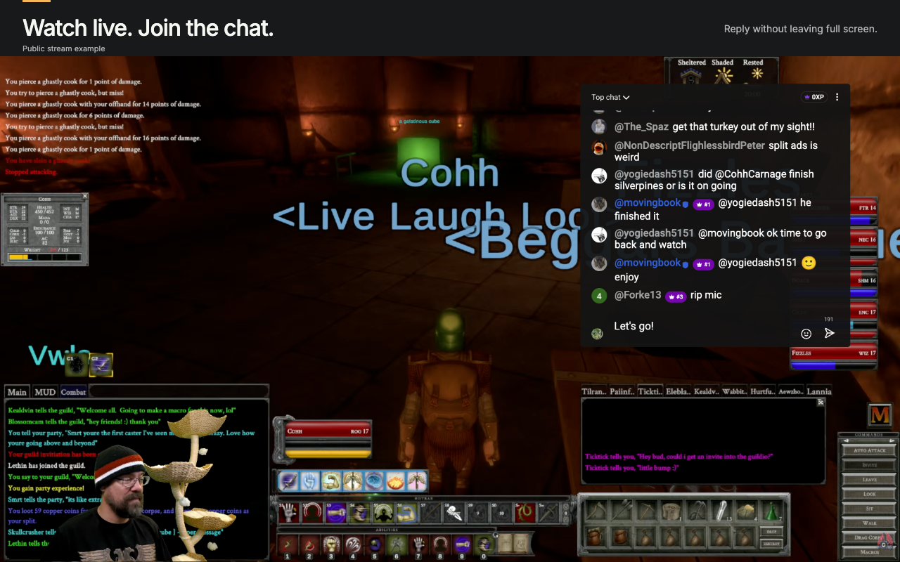

# Chrome Web Store assets

**Saved as a Chrome Web Store draft on 2026-10-16 (JST):** the selected discovery tile, three global screenshots and all **55 detailed descriptions**. The draft has **not been submitted for review or published**. [Draft evidence](source/store-draft-20261016.json) and the [55-locale dashboard snapshot](../../store-listing/chrome-dashboard-snapshot-2026-10-16.json) record the saved values. Short descriptions remain prepared for the normal package release; no package was uploaded, and both published and draft package versions remain **2.3.15**.

Three real live-stream captures and five English-first exports were accepted on 2026-10-14 (JST). These captures show the **2.3.16 production extension**, loaded unpacked in a dedicated regular-Chrome profile.



## Current images and copy

**Selected discovery tile — 2026-10-16:** [06 — インディゴの重なり](listing-promo/selected-20261016/README.md), selected by the user from the refined text-free set. The [440 × 280 upload PNG](listing-promo/selected-20261016/small-promo.png) and [880 × 560 review PNG](listing-promo/selected-20261016/small-promo@2x.png) preserve the approved artwork exactly. [Selection evidence and hashes](listing-promo/selected-20261016/selection.json) are recorded. No store publication has been performed. The [ten-concept gallery](listing-promo/refined-text-free-imagegen-20261015/index.html) and older explorations remain preserved.

| Asset | Output | Size |
| --- | --- | --- |
| Selected small promotional tile — Indigo overlay | [PNG](listing-promo/selected-20261016/small-promo.png) | 440 × 280 |
| 1. Live gaming — “Watch live. Join the chat.” | [PNG](exports/en/01-live-gaming.png) | 1280 × 800 |
| 2. VTuber community — “Watch VTubers. Join the fun.” | [PNG](exports/en/02-vtuber-live.png) | 1280 × 800 |
| 3. Transparent chat — “Let the stream show through.” | [PNG](exports/en/03-transparent-chat.png) | 1280 × 800 |
| Text-free indigo marquee — draft saved by user 2026-10-16 | [PNG](listing-promo/marquee-indigo-20261016/marquee.png) | 1400 × 560 |
| Capture-based small promotional tile (earlier alternative) | [PNG](exports/small-promo.png) | 440 × 280 |
| Capture-based marquee promotional tile (earlier alternative) | [PNG](exports/marquee.png) | 1400 × 560 |

The [matching indigo marquee](listing-promo/marquee-indigo-20261016/README.md) is a newly generated, text-free illustration based on the selected discovery tile. Its [prompt](listing-promo/marquee-indigo-20261016/prompt.md), original, half-size preview and hashes are repository-managed. The user reported saving it in the store draft on **2026-10-16**. This follow-up has not been independently checked in the dashboard; the [user-reported save record](source/store-draft-marquee-20261016.json) is separate from the earlier verified draft evidence.

The gaming and transparency examples use CohhCarnage's stream. The VTuber example uses Gigi Murin's stream, including Raora Panthera's avatar. [Stream provenance](source/stream-provenance.md) keeps public source links and attribution. These examples do not imply the creators use or endorse the extension.

Each source is an untouched **1920 × 1080 PNG** captured from the browser's native fullscreen page surface. Each screenshot adds an 80 px English heading above the complete video, uniformly displayed at **1280 × 720**. Both earlier capture-based promotional tiles preserve the same complete gaming capture: the small tile below a heading strip, the marquee beside the copy. No source pixels, native controls, or chat were repainted or recreated. Output sizes follow the [Chrome Web Store image guidelines](https://developer.chrome.com/docs/webstore/images) and [listing dashboard guide](https://developer.chrome.com/docs/webstore/cws-dashboard-listing).

The real native composer is visible, editable and unobstructed in all three captures. An unsent draft was shown in the actual input, then cleared; no message was sent. The overlay uses **22 px** source text, **3 px** message spacing, **30%** video width and **52%** video height. The VTuber panel is on the left, keeping the avatars visible. The transparent variant uses **40% background opacity with 4 px blur**, so the stream shows through while the chat remains legible.

- Primary detailed description: [English](../../store-listing/en.md), also used for [Australia](../../store-listing/en_AU.md), [United Kingdom](../../store-listing/en_GB.md), and [United States](../../store-listing/en_US.md).
- Localized descriptions: [all 55 language and region options](source/listing-copy-locales.md), including [Japanese](../../store-listing/ja.md).
- Package titles and summaries: [all 55 options](source/package-metadata.md), with [source references](copy.json). Both fields are synchronized to their package translation sources.
- Copy rationale and search-intent mapping: [listing-copy-strategy.md](source/listing-copy-strategy.md), updated on 2026-10-16.
- Publication status: [asset work list](../../store-listing/asset-work-list.md).

The package title and summary come from `extensionName` and `extensionDescription` in `shared/i18n/assets/*.json`. All 55 package titles have been reviewed, and summaries in `copy.json` match those authored sources. English uses the exact formal name; other languages add one localized functional descriptor. Every detailed description was revised on 2026-10-16 for clear search intent and feature discovery, using plain local wording while preserving product facts. Posting and paid features depend on YouTube login and eligibility; archives need an available chat replay. The [locale inventory](source/listing-copy-locales.json) records source hashes and review scope.

## Captures and verification

The user completed manual login in a retained, ignored dedicated **Google Chrome 155.0.8059.40** profile. The extension manager verified the exact enabled `.output/chrome-mv3` path and **2.3.16** identity. The user explicitly approved temporarily foregrounding only this dedicated capture window. Normal Chrome retained its native User-Agent.

Native YouTube fullscreen and playing video were checked at capture time. The gaming source decoded at **2560 × 1440**, the VTuber source at **1920 × 1080**. Browser window bounds and capture dimensions are recorded separately: the fullscreen window reported width 1920, top 88 and height 992, while the exact **1920 × 1080** page capture viewport and clip were established on the same capture CDP session. The PNG dimensions prove the capture surface; they do not describe the physical window frame.

[capture-evidence.json](capture-evidence.json) records identity, capture bounds, checked behavior, settings and original hashes. [verification.md](verification.md) records the real-site scope and export review. [development-verification.md](development-verification.md) separates accepted real images from offline fixture proof and earlier failed capture attempts. The [variation record](source/live-variations.plan.json) selects all three accepted PNGs, with five rendered outputs.

The current inputs are `inputs/en/live-gaming.png`, `vtuber-live.png`, and `transparent-live.png`. Their matching anonymous settings patches are [live gaming](source/settings/live-gaming.json), [VTuber live](source/settings/vtuber-live.json), and [transparent live](source/settings/transparent-live.json). The [capture guide](source/capture-guide.md) explains how to refresh them. Native YouTube UI was temporarily set to English during capture.

After capture, native video quality was restored to **Auto** on both sources, YouTube UI was restored to **Japanese**, and drafts were blank. The exact owned Chrome was closed; the dedicated authenticated profile was retained.

[exports/manifest.json](exports/manifest.json) records dimensions, bundled fonts, input/source hashes, output hashes and the capture evidence used by the current composition. All five output hashes matched the manifest. Full-size and reduced-size review found no material clipping or overlap; headings, avatars and native composers remain clear. Secondary captions and chat text are not expected to be readable at the small promotional preview sizes. A still image alone does not establish message submission, replay synchronization, settings UI behavior or compatibility with every stream.

## Earlier assets and fixture sources

The reviewed **2026-10-13 PrimeTime archive set**, captured with the published **2.3.15** extension, is preserved in [history/archive-20261013](history/archive-20261013/README.md), including its evidence, composition, verification record and five exports. Its original `overview.jpg`, `position-left.jpg`, `archive.jpg` and raw captures remain under `inputs/`. Its blank settings-panel and extension-manager limitations remain historical observations; these archive images are no longer selected by the renderer.

The generated rainy-street demo is isolated in `fixtures/inputs/` and [fixtures/capture-evidence.json](fixtures/capture-evidence.json). Its [scene](source/scene-v2.png) and [generation provenance](source/scene-v2-prompt.md) remain fixture sources. Deterministic YouTube DOM and fictional messages support repeatable production UI checks; they do not certify external playback, live delivery or authentication, and are not selected as real store imagery.

## Edit and render

Use Node.js 24 and the pinned Yarn; follow the [contribution guide](../../../CONTRIBUTING.md) for dependencies. If the Playwright browser is missing:

```bash
yarn playwright install chromium
```

Follow the [capture guide](source/capture-guide.md) to prepare genuine inputs and evidence. Edit [source/composition.json](source/composition.json) for copy and input selection, and [source/gallery.html](source/gallery.html) for layout. The composition labels the images **Public stream example**. Export only after selected inputs and their evidence exist:

```bash
yarn store:assets:render --check
yarn store:assets:render
yarn store:check
```

[source/render.mjs](source/render.mjs) supports one to five screenshots and two promotional images. It accepts PNG and JPEG captures, checks dimensions against `captureSize`, preserves displayed 16:9 proportions, validates promotional bounds, output sizes and copy overflow, then refreshes the manifest. Inter 400/500 is bundled under its [SIL Open Font License](source/fonts/LICENSE). Product UI fonts come from the captured browser.

The repeatable synthetic capture remains separate:

```bash
yarn store:assets:capture
```

This builds `.output/chrome-mv3`, checks extension identity, exercises the production UI in a disposable Chrome for Testing profile, and writes **only** to `fixtures/inputs/` and `fixtures/capture-evidence.json`. The temporary profile is removed afterward.

Review screenshots at full size and **640 × 400**, the small tile at **220 × 140**, and the marquee at **700 × 280**. Preserve complete video, native interface and creator credit. When executable capture/render logic changes, run `yarn verify`. Keep public source links in provenance; diagnostic reports exclude watch URLs, video IDs, usernames, chat messages and account data.

Generation manifests retain the source hashes recorded when images were exported. [Post-generation formatting](source/post-generation-formatting.json) records source files subsequently formatted for repository checks; exported image bytes were preserved.
