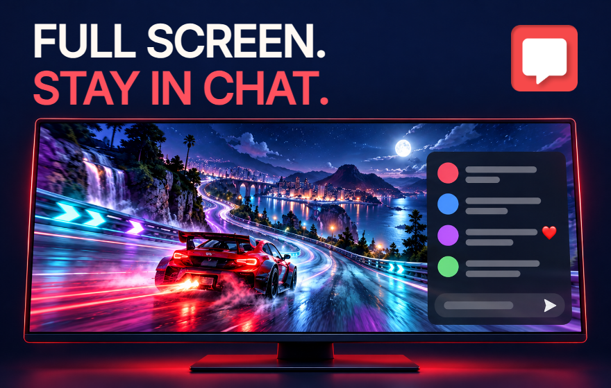

# Chrome Web Store listing promo

An earlier English-first **440 × 280** discovery-tile draft, created on **2026-10-14 (JST)**. The user selected **06 — インディゴの重なり** from the refined text-free set on **2026-10-16 (JST)**. [Selected upload files and selection record](selected-20261016/README.md) are saved separately. The [ten-concept gallery](refined-text-free-imagegen-20261015/index.html) and earlier explorations remain preserved. The store listing has not been updated.



## Deliverables

| File | Size | Purpose |
| --- | --- | --- |
| [small-promo.png](exports/small-promo.png) | 440 × 280 | Upload to the dashboard's small promotional tile field |
| [small-promo@2x.png](exports/small-promo@2x.png) | 880 × 560 | Larger review / sharing copy; not the store upload size |
| [preview-half.png](exports/preview-half.png) | 220 × 140 | Actual half-size legibility review |

All three are **24-bit RGB PNGs without alpha**. The 440 × 280 export follows the [official image specification](https://developer.chrome.com/docs/webstore/images). Chrome recommends limiting text and visual detail and reviewing promo tiles at half size in its [listing guidance](https://developer.chrome.com/docs/webstore/best-listing).

The headline is **FULL SCREEN. / STAY IN CHAT.** The existing red chat-bubble icon links the artwork to the extension. An original racing-stream illustration shows a single chat panel with a composer over the video; the scene uses red, violet and teal to convey a gaming stream.

## Source and reproduction

- [composition.json](source/composition.json): English headline and source selection.
- [tile.html](source/tile.html): editable typography, placement and icon.
- [stream-illustration.png](source/stream-illustration.png): selected, unchanged generated original.
- [prompt.md](source/prompt.md): complete prompts for the built-in `image_gen` generation and selected revision.
- [render.mjs](source/render.mjs): repeatable local export with bundled Inter and the repository icon.
- [manifest.json](exports/manifest.json): source/output hashes, exact dimensions and PNG color type.
- `source/stream-illustration-v1.png`: exploratory panoramic version, retained as a design reference and not selected.

With Node.js 24 and repository dependencies installed, run from the repository root:

```bash
node docs/store-assets/chrome-web-store/listing-promo/source/render.mjs
```

The renderer checks the illustration's aspect ratio, exact headline, copy bounds, overlap with the icon, all three output dimensions and opaque RGB PNG format. It displays the entire selected illustration without cropping or stretching. Inter 500 is shared with the [existing asset source](../source/fonts/LICENSE), with browser-synthesized bold. The app icon is unchanged.

## Review and scope

The 440 × 280 upload, 880 × 560 review copy and 220 × 140 preview were rendered and visually inspected. The two-line heading, app icon, racing video, chat overlay and input triangle remain distinct at half size. Source and output hashes are recorded in the manifest.

The render checks passed for all three opaque RGB PNGs, all eight source hashes and all three output hashes matched, and local documentation links resolved. The final `yarn verify` passed **963 tests** (799 core/DOM and 164 contracts). A sandbox-only browser launch / local-port limitation was resolved by running the required operations with the permitted local execution scope.

The racing scene and simplified chat are **original promotional illustration**, not a real stream, real comments or a product screenshot. No actual creator, external footage, endorsement, store ranking or featured badge is depicted. Actual product behavior is shown in the [three genuine live-stream screenshots](../README.md). This tile has not been uploaded to the store.
