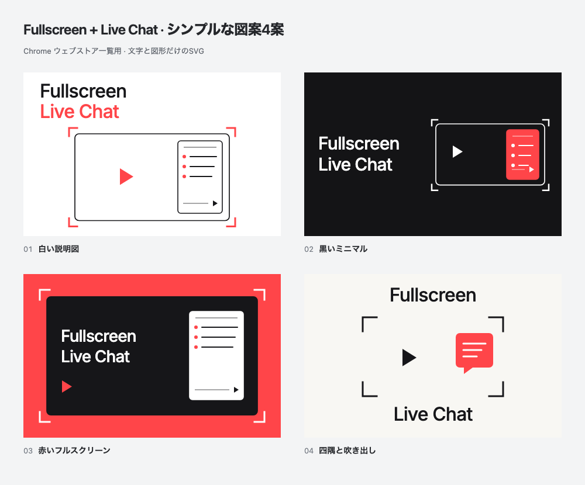

# Abstract Fullscreen + Live Chat diagrams

Four flat vector proposals created on **2026-10-15 (JST)**. The artwork uses editable SVG text, fullscreen corners, one 16:9 video frame and a chat shape inside the video. **No image-generation model, photographs, invented conversation or textured scene is used.**



[Open the comparison gallery](index.html) to switch between **440 × 280** and **220 × 140**, or click a tile for its **880 × 560** export.

| No. | Direction | Upload PNG | Editable vector |
| --- | --- | --- | --- |
| 01 | White explanatory diagram | [440 × 280](exports/01.png) | [SVG](vectors/01.svg) |
| 02 | Dark minimal composition | [440 × 280](exports/02.png) | [SVG](vectors/02.svg) |
| 03 | Red fullscreen stage | [440 × 280](exports/03.png) | [SVG](vectors/03.svg) |
| 04 | Fullscreen corners and speech bubble | [440 × 280](exports/04.png) | [SVG](vectors/04.svg) |

**04 is the strongest abstract direction:** it reduces the product to the fullscreen corners, play symbol and speech bubble. **01 explains the feature most literally:** the chat panel is clearly inset inside the video and includes a simple input/send cue. These are creative judgments, not store-performance measurements.

## Edit and export

[source/artwork.mjs](source/artwork.mjs) is the canonical editable design source: colors, text, geometry and placement are explicit. [source/render.mjs](source/render.mjs) writes the standalone SVGs and PNGs. [source/gallery.html](source/gallery.html) owns the comparison page.

From the repository root, with Node.js 24 and dependencies installed:

```bash
node docs/store-assets/chrome-web-store/listing-promo/abstract-20261015/source/render.mjs
```

The four SVGs embed the repository's bundled **Inter 500** font so their lettering can render without external font requests. The [font license](vectors/FONT-LICENSE.txt) accompanies them. Edit the canonical source and rerender; files under `vectors/` and `exports/` are generated outputs.

Each proposal has an opaque **24-bit RGB PNG** at 440 × 280, an 880 × 560 review export (`@2x`) and a 220 × 140 preview (`-half`). [concepts.json](concepts.json) records gallery labels. [exports/manifest.json](exports/manifest.json) records source/output hashes and checks. No direction is selected or published.

## Verification

The renderer checks exact main text **Fullscreen / Live Chat**, loaded embedded font, text bounds, a 16:9 video area, chat containment with at least 8 px inset, and no headline/chat overlap. It rejects raster scene inserts, filters, gradients and external image resources.

All four full-size images, the comparison sheet and all four actual 220 × 140 previews were visually inspected. No material clipping or overlap was found. Actual browser interaction checks cover the half-size toggle, selected larger image, Escape, full-size restoration and a 375 px mobile viewport.

The export produced **four standalone SVGs and 13 RGB PNGs**. All source/output hashes and PNG dimensions matched the manifest. The final `yarn verify` passed **963 tests** (799 core/DOM and 164 contracts).

The [previous YouTube-like concepts](../concepts-youtube-chat-20261015/README.md) remain preserved. [Genuine live-stream screenshots](../../README.md) remain separate; these SVGs are explanatory diagrams. No extension runtime, icon or store listing was changed.
