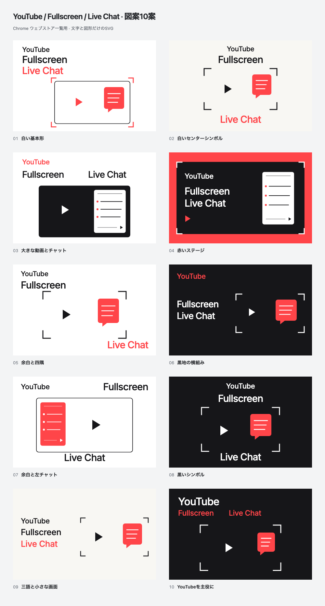

# YouTube / Fullscreen / Live Chat: ten abstract diagrams

Ten simple vector proposals created on **2026-10-15 (JST)**. Every tile visibly includes **YouTube**, **Fullscreen** and **Live Chat**. All artwork uses editable text and flat red, black and white geometry.



[Open the comparison gallery](index.html) to switch between **440 × 280** and actual **220 × 140** views, or click a tile for its **880 × 560** export.

| No. | Direction | Upload PNG | Vector |
| --- | --- | --- | --- |
| 01 | White basic diagram | [PNG](exports/01.png) | [SVG](vectors/01.svg) |
| 02 | Centered white symbol | [PNG](exports/02.png) | [SVG](vectors/02.svg) |
| 03 | Large video and chat | [PNG](exports/03.png) | [SVG](vectors/03.svg) |
| 04 | Red stage | [PNG](exports/04.png) | [SVG](vectors/04.svg) |
| 05 | Whitespace and corners | [PNG](exports/05.png) | [SVG](vectors/05.svg) |
| 06 | Horizontal dark composition | [PNG](exports/06.png) | [SVG](vectors/06.svg) |
| 07 | Whitespace and left chat | [PNG](exports/07.png) | [SVG](vectors/07.svg) |
| 08 | Dark fullscreen symbol | [PNG](exports/08.png) | [SVG](vectors/08.svg) |
| 09 | Three terms and a small frame | [PNG](exports/09.png) | [SVG](vectors/09.svg) |
| 10 | YouTube as the main heading | [PNG](exports/10.png) | [SVG](vectors/10.svg) |

**02 and 08** are the strongest continuations of the simple symbol direction, in light and dark treatments. **03** explains video-plus-chat most literally. These are creative judgments, not measured store performance. No proposal is selected or published.

## Editable source

- [artwork.mjs](source/artwork.mjs): shared vector primitives and proposals 01–03 / 10.
- [variants-04-06.mjs](source/variants-04-06.mjs) and [variants-07-09.mjs](source/variants-07-09.mjs): the other six layouts.
- [render.mjs](source/render.mjs): standalone SVGs, PNGs and validation.
- [gallery.html](source/gallery.html): responsive comparison and enlarged view.
- [manifest.json](exports/manifest.json): source/output hashes and verification results.

The diagrams use one 16:9 video boundary and a chat panel or speech bubble inset inside it. Text is set in the repository's bundled **Inter 500**, embedded in each standalone SVG. The [font license](vectors/FONT-LICENSE.txt) accompanies the exports. No image-generation model, scene, photography, gradient, shadow or fabricated conversation is used.

Edit the canonical modules and rerender. Files under `vectors/` and `exports/` are generated outputs. From the repository root with Node.js 24 and dependencies installed:

```bash
node docs/store-assets/chrome-web-store/listing-promo/abstract-youtube-20261015/source/render.mjs
```

Each tile has an opaque **24-bit RGB PNG** at **440 × 280**, a review copy at **880 × 560** (`@2x`) and a thumbnail check at **220 × 140** (`-half`). The [numbered comparison](exports/comparison.png) shows all ten.

## Verification

The renderer checks exact visible text YouTube / Fullscreen / Live Chat, embedded-font loading, safe text bounds, no text/chat overlap, a 16:9 video boundary and at least 8 px chat inset. It also checks image dimensions and RGB format. Gallery interactions cover the real half-size toggle, requested enlarged image, Escape, full-size restoration and 375 px layout.

All ten tiles and all ten 220 × 140 previews were visually inspected. All three terms remain readable, with no material clipping or overlap. The export set contains **ten standalone SVGs and 31 RGB PNGs**, including the comparison.

All source/output hashes, PNG sizes and RGB format matched the manifest. The final `yarn verify` passed **963 tests** (799 core/DOM and 164 contracts).

The [first four abstract diagrams](../abstract-20261015/README.md) and [earlier image-based concepts](../concepts-youtube-chat-20261015/README.md) remain preserved. These are explanatory diagrams; [genuine product screenshots](../../README.md) remain separate. No extension runtime, product icon or store listing was changed.
