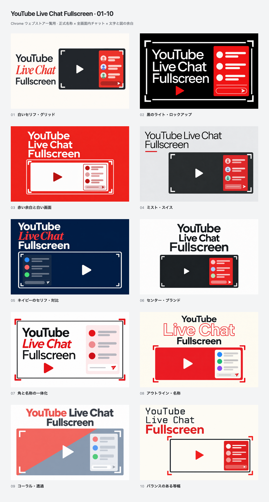
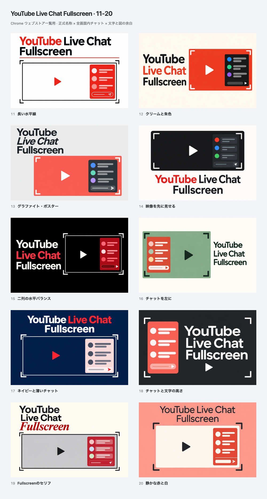

# YouTube Live Chat Fullscreen: twenty more directions

Twenty additional concepts individually generated with **GPT Image through the built-in `image_gen` tool** on **2026-10-15 (JST)**. Every artwork uses **YouTube Live Chat Fullscreen**, in that reading order. Typography, fullscreen corners, video and an inset chat pane are composed together with variations in palette, whitespace and alignment.





[Open the gallery](index.html) to compare at **440 × 280** or actual **220 × 140**, and click any tile for its **880 × 560** review copy. No direction is selected or published.

| No. | Direction | Upload PNG | Enlarged |
| --- | --- | --- | --- |
| 01 | 白いセリフ・グリッド | [PNG](exports/01.png) | [Review](exports/01@2x.png) |
| 02 | 黒のライト・ロックアップ | [PNG](exports/02.png) | [Review](exports/02@2x.png) |
| 03 | 赤い余白と白い画面 | [PNG](exports/03.png) | [Review](exports/03@2x.png) |
| 04 | ミスト・スイス | [PNG](exports/04.png) | [Review](exports/04@2x.png) |
| 05 | ネイビーのセリフ・対比 | [PNG](exports/05.png) | [Review](exports/05@2x.png) |
| 06 | センター・ブランド | [PNG](exports/06.png) | [Review](exports/06@2x.png) |
| 07 | 角と名称の一体化 | [PNG](exports/07.png) | [Review](exports/07@2x.png) |
| 08 | アウトライン・名称 | [PNG](exports/08.png) | [Review](exports/08@2x.png) |
| 09 | コーラル・透過 | [PNG](exports/09.png) | [Review](exports/09@2x.png) |
| 10 | バランスのある等幅 | [PNG](exports/10.png) | [Review](exports/10@2x.png) |
| 11 | 長い水平線 | [PNG](exports/11.png) | [Review](exports/11@2x.png) |
| 12 | クリームと朱色 | [PNG](exports/12.png) | [Review](exports/12@2x.png) |
| 13 | グラファイト・ポスター | [PNG](exports/13.png) | [Review](exports/13@2x.png) |
| 14 | 映像を先に見せる | [PNG](exports/14.png) | [Review](exports/14@2x.png) |
| 15 | 二列の水平バランス | [PNG](exports/15.png) | [Review](exports/15@2x.png) |
| 16 | チャットを左に | [PNG](exports/16.png) | [Review](exports/16@2x.png) |
| 17 | ネイビーと薄いチャット | [PNG](exports/17.png) | [Review](exports/17@2x.png) |
| 18 | チャットと文字の高さ | [PNG](exports/18.png) | [Review](exports/18@2x.png) |
| 19 | Fullscreenのセリフ | [PNG](exports/19.png) | [Review](exports/19@2x.png) |
| 20 | 静かな赤と白 | [PNG](exports/20.png) | [Review](exports/20@2x.png) |

## Source and reproduction

- `originals/01.png` through `20.png`: chosen generated originals.
- `metadata/01.json` through `20.json`: exact generation/revision prompts, descriptions and provenance.
- [prompts.md](prompts.md): collected exact prompt set.
- [concepts.json](concepts.json): selected inventory.
- [source/render.mjs](source/render.mjs), [tile.html](source/tile.html) and [gallery.html](source/gallery.html): repeatable exports and responsive comparison.
- [exports/manifest.json](exports/manifest.json): source/output hashes, dimensions, color format and gallery checks.

Each original produces an opaque **440 × 280 RGB PNG**, an **880 × 560** review copy and a **220 × 140** preview. Five comparison sheets cover all twenty, the two numbered groups and odd/even numbers: **65 PNG exports** in total. The renderer uniformly fits the complete original without crop, stretching or replacement text. Generated aspect ratios may differ by up to 3% from 11:7; a matching matte fills any narrow remainder.

From the repository root with Node.js 24 and pinned Yarn dependencies installed:

```bash
node docs/store-assets/chrome-web-store/listing-promo/balanced-name-20-imagegen-20261015/source/render.mjs
```

This reproduces exports from saved originals. Generating replacement artwork requires a fresh image-generation call and is not deterministic. In-image lettering is part of each bitmap; font references in prompts describe visual direction, not certify an installed font.

## Review

All twenty selected artworks, both ten-image comparison sheets and every **220 × 140** preview were visually reviewed. The official name reads YouTube → Live Chat → Fullscreen in all twenty, with no missing or clipped letters. Each video boundary encompasses its inset chat, with fullscreen corners and a play symbol visible. 16's type was reduced after thumbnail review to restore outer whitespace.

**04, 15 and 20** offer strong alternatives for quiet typography, dark horizontal balance and a softer coral palette respectively. This is a creative judgment rather than measured store performance. 05 and 14 have subdued dark chat strokes; some other directions deliberately use stronger display weights.

The renderer and final checks passed for **46 source hashes**, **65 opaque RGB PNGs**, exact dimensions and output hashes. Gallery checks cover half-size comparison, enlarged export identity, Escape, full-size restoration and 375 px layout. The final `yarn verify` passed **963 tests** (799 core/DOM and 164 contracts).

The initial 03/04/06/16 drafts remain in `history/`; selected revisions correct the fullscreen boundary or name spacing. Diagrams use schematic proportions rather than pixel-accurate product UI. These are original promotional graphics, not genuine product screenshots.

The [previous ten balanced concepts](../balanced-name-imagegen-20261015/README.md) and older explorations remain preserved. [Genuine product screenshots](../../README.md) remain separate. No extension runtime, product icon or store listing is changed.
