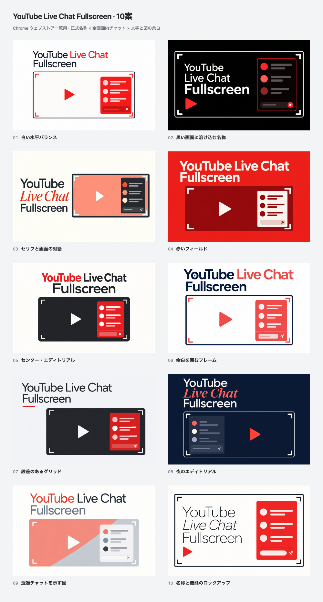

# YouTube Live Chat Fullscreen: balanced-name concepts

Ten promotional concepts individually generated with **GPT Image through the built-in `image_gen` tool** on **2026-10-15 (JST)**. Every artwork uses the official name **YouTube Live Chat Fullscreen**, in that exact reading order. This round composes the name, a substantial fullscreen-video diagram and inset chat together, using whitespace, alignment, palette and type hierarchy as one identity.



[Open the comparison gallery](index.html) for full-size, **220 × 140** and enlarged views. No concept is selected or published.

| No. | Direction | Upload PNG | Review |
| --- | --- | --- | --- |
| 01 | 白い水平バランス | [PNG](exports/01.png) | [880 × 560](exports/01@2x.png) |
| 02 | 黒い画面に溶け込む名称 | [PNG](exports/02.png) | [880 × 560](exports/02@2x.png) |
| 03 | セリフと画面の対話 | [PNG](exports/03.png) | [880 × 560](exports/03@2x.png) |
| 04 | 赤いフィールド | [PNG](exports/04.png) | [880 × 560](exports/04@2x.png) |
| 05 | センター・エディトリアル | [PNG](exports/05.png) | [880 × 560](exports/05@2x.png) |
| 06 | 余白を囲むフレーム | [PNG](exports/06.png) | [880 × 560](exports/06@2x.png) |
| 07 | 段差のあるグリッド | [PNG](exports/07.png) | [880 × 560](exports/07@2x.png) |
| 08 | 夜のエディトリアル | [PNG](exports/08.png) | [880 × 560](exports/08@2x.png) |
| 09 | 透過チャットを示す図 | [PNG](exports/09.png) | [880 × 560](exports/09@2x.png) |
| 10 | 名称と機能のロックアップ | [PNG](exports/10.png) | [880 × 560](exports/10@2x.png) |

## Files and reproduction

- `originals/01.png` through `10.png`: chosen generated originals, retained without repainting.
- `metadata/01.json` through `10.json`: concept descriptions, exact generation/revision prompts and provenance.
- [prompts.md](prompts.md): collected prompt set.
- [concepts.json](concepts.json): gallery inventory.
- [source/render.mjs](source/render.mjs), [tile.html](source/tile.html) and [gallery.html](source/gallery.html): repeatable image fitting and interactive comparison.
- [exports/manifest.json](exports/manifest.json): source/output hashes, dimensions, color format and gallery checks.

Each chosen original has a **440 × 280** opaque RGB PNG for store upload, an **880 × 560** review copy (`@2x`) and a **220 × 140** thumbnail (`-half`). The renderer uniformly fits the whole original without cropping, stretching or adding replacement text. Generated proportions may differ by up to 3% from 11:7; a matching matte fills any narrow remainder. Numbered captions appear outside the artworks on comparison sheets.

From the repository root with Node.js 24 and the pinned Yarn dependencies installed:

```bash
node docs/store-assets/chrome-web-store/listing-promo/balanced-name-imagegen-20261015/source/render.mjs
```

This command reproduces exports from the saved originals. Generating replacement artwork requires a fresh image-generation call using the saved prompt; model output is not deterministic.

## Review

All ten selected originals, the comparison and every **220 × 140** preview were visually inspected. The official name reads **YouTube → Live Chat → Fullscreen** in every artwork, with no clipped or missing letters. Every diagram places its chat inside the fullscreen-video boundary, with corner marks and a play symbol visible. These are schematic proportions rather than pixel-accurate product UI.

**03** balances the editorial lettering against the video diagram most clearly; **10** integrates the complete name and chat inside one fullscreen frame; **07** offers a quieter asymmetric layout. These are creative judgments, not measured store performance. Chat in 08 has deliberately subdued contrast, while 09 emphasizes a pale overlay treatment.

The final checks passed for **26 source hashes**, **33 opaque RGB PNGs** and their dimensions/output hashes. Gallery checks cover the actual 220 × 140 toggle, enlarged export identity, Escape, full-size restoration and 375 px layout. The final `yarn verify` passed **963 tests** (799 core/DOM and 164 contracts).

All in-image lettering is part of the generated bitmap; rendering code only fits and exports the image. Typeface references in prompts describe visual direction rather than certify a particular installed font. The renderer checks the exact official name in metadata; reading order and lettering in the actual artwork require visual review.

The earlier scenic drafts for 01 and 03 remain in `history/` and are not selected. Chosen originals use abstract video surfaces and chat shapes, not genuine product screenshots. The [actual product screenshots](../../README.md), [previous typography-led concepts](../typography-imagegen-20261015/README.md) and older explorations remain preserved. No extension runtime, product icon or store listing is changed.
