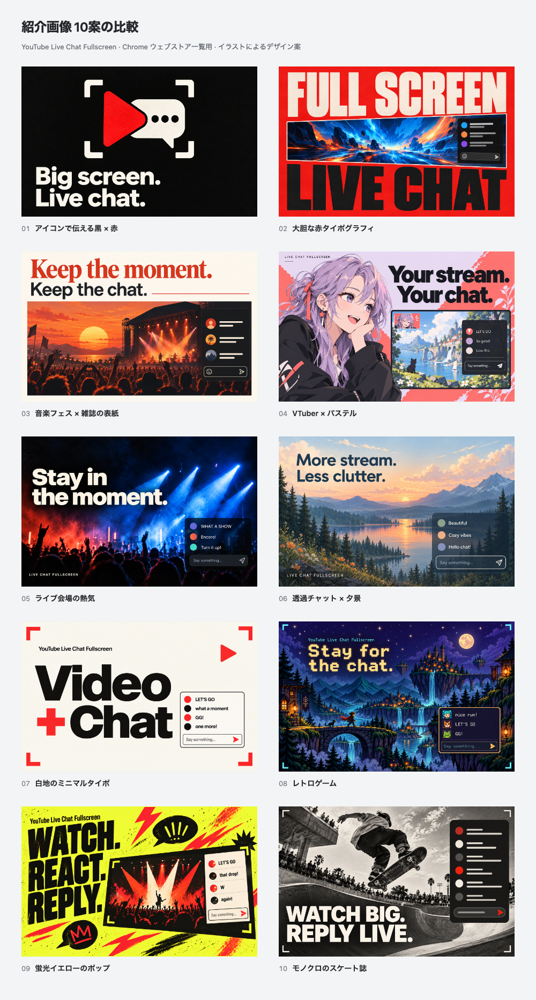

# Ten listing-image directions

**Ten distinct English-first promotional concepts**, prepared on **2026-10-14 (JST)** for YouTube Live Chat Fullscreen. This is a design exploration. **No concept is selected or published.**



[Open the comparison gallery](index.html) to switch between **440 × 280** and **220 × 140**, or click an image to inspect the **880 × 560** version. The standalone gallery has embedded metadata and local image references; it can be opened directly in a browser.

## The directions

| No. | Direction | Main English copy | 440 × 280 PNG |
| --- | --- | --- | --- |
| 01 | Iconic black / red | Big screen. Live chat. | [01](exports/01.png) |
| 02 | Red typographic poster | FULL SCREEN / LIVE CHAT | [02](exports/02.png) |
| 03 | Warm editorial / music festival | Keep the moment. Keep the chat. | [03](exports/03.png) |
| 04 | Original VTuber / pastel editorial | Your stream. Your chat. | [04](exports/04.png) |
| 05 | Live concert atmosphere | Stay in the moment. | [05](exports/05.png) |
| 06 | Calm landscape / transparent chat | More stream. Less clutter. | [06](exports/06.png) |
| 07 | Minimal type / off-white and red | Video + Chat | [07](exports/07.png) |
| 08 | Retro adventure game | Stay for the chat. | [08](exports/08.png) |
| 09 | Acid-yellow fan poster | WATCH. REACT. REPLY. | [09](exports/09.png) |
| 10 | Monochrome skate editorial | WATCH BIG. REPLY LIVE. | [10](exports/10.png) |

02 and 07 have the clearest small-size function / typography; 04 targets VTuber fans and 09 emphasizes live participation. 06 takes a quieter direction around transparency. These are creative judgments, not store-performance measurements.

If 03 is selected, refine its copy so it clearly means staying with the stream rather than recording or saving it. The pixel styling in 08 is an illustration treatment, not a claim that the extension ships a pixel-chat theme.

## Repository sources

- [concepts.json](concepts.json): normalized gallery metadata, source dimensions and hashes.
- [prompts.md](prompts.md): the complete generation and recomposition prompt set, using **built-in image_gen**.
- `metadata/01.json` through `10.json`: each direction's brief and source notes.
- `originals/01.png` through `10.png`: selected original tool outputs, retained unchanged.
- [gallery.html](source/gallery.html): editable comparison-page layout and interactions.
- [tile.html](source/tile.html) and [render.mjs](source/render.mjs): whole-image export and validation.
- [manifest.json](exports/manifest.json): all source and export hashes, sizes and gallery checks.

Every direction has a **440 × 280 upload candidate**, **880 × 560 review copy** (`@2x`) and **220 × 140 preview** (`-half`). All exports are opaque **24-bit RGB PNGs**, with complete source images uniformly fitted and no crop or stretching. The original aspect ratios differ slightly because imagegen returns integer canvas dimensions.

The [comparison PNG](exports/comparison.png) has numbered labels outside the artwork. [Odd-numbered](exports/comparison-odd.png) and [even-numbered](exports/comparison-even.png) sheets provide larger single-column reviews.

With Node.js 24 and repository dependencies installed, run from the repository root:

```bash
node docs/store-assets/chrome-web-store/listing-promo/concepts-20261014/source/render.mjs
```

The renderer requires exactly ten complete concepts and checks source aspect ratios, selected source identity, all output dimensions and PNG color format. It rebuilds the embedded local gallery, prompt index and manifest. Browser checks exercise the real half-size toggle, requested expanded export, Escape, full-size restoration and a 375 px mobile viewport.

## Verification and scope

All ten originals and the numbered comparison were visually inspected. Headline spelling and clipping were checked; small in-image brand labels and fictional chat text are secondary at the smallest scale. The renderer produced **30 individual PNGs and three comparison sheets**. The final `yarn verify` passed **963 tests** (799 core/DOM and 164 contracts). Source/output hashes and image dimensions are recorded in the manifest.

All scenes, performers, characters and chat samples are **original promotional artwork / illustrative UI**, not real creators, genuine chat messages or real product screenshots. The [genuine live-stream screenshots](../../README.md) remain separate. No actual extension logo, runtime, release version or published store listing was changed by this exploration.
