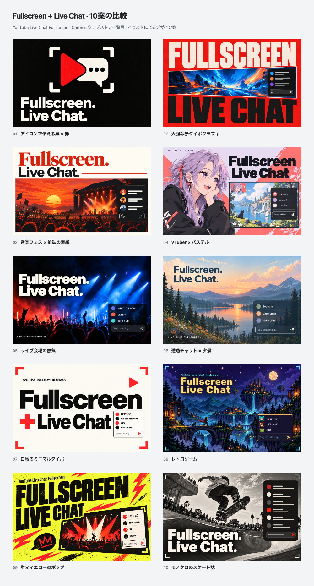

# Fullscreen + Live Chat: ten directions

**Ten English-first promotional directions**, revised on **2026-10-14 (JST)** for YouTube Live Chat Fullscreen. **Every main heading includes Fullscreen as one word and Live Chat as a phrase.** No concept has been selected or published.



[Open the interactive comparison](index.html) for actual **440 × 280** and **220 × 140** views, or click a concept to inspect its **880 × 560** version.

| No. | Direction | 440 × 280 PNG |
| --- | --- | --- |
| 01 | Iconic black / red | [01](exports/01.png) |
| 02 | Bold red typography | [02](exports/02.png) |
| 03 | Warm music-festival editorial | [03](exports/03.png) |
| 04 | Original VTuber / pastel | [04](exports/04.png) |
| 05 | Live concert atmosphere | [05](exports/05.png) |
| 06 | Calm landscape / transparent chat | [06](exports/06.png) |
| 07 | Minimal off-white typography | [07](exports/07.png) |
| 08 | Retro adventure game | [08](exports/08.png) |
| 09 | Acid-yellow fan poster | [09](exports/09.png) |
| 10 | Monochrome skate editorial | [10](exports/10.png) |

Both required terms are part of the large main type. The uppercase treatments use **FULLSCREEN**, without an internal space. Some directions add punctuation or a plus sign. All are original promotional artwork / illustrative UI; the [genuine live-stream screenshots](../../README.md) remain separate.

## Editable source and prompts

- [concepts.json](concepts.json): gallery metadata, original sizes and hashes.
- [prompts.md](prompts.md): complete prompts for the built-in `image_gen` edits and any refinements.
- `metadata/01.json` through `10.json`: individual briefs, required words and reference images.
- `originals/01.png` through `10.png`: unchanged selected tool outputs.
- [gallery.html](source/gallery.html): comparison layout, actual half-size view and expanded-image dialog.
- [tile.html](source/tile.html) and [render.mjs](source/render.mjs): repeatable whole-image exports.
- [manifest.json](exports/manifest.json): source/output hashes, image sizes and gallery checks.

All directions have **440 × 280** upload candidates, **880 × 560** review copies (`@2x`) and **220 × 140** previews (`-half`). Exports are opaque **24-bit RGB PNGs**; complete originals are fitted uniformly without source cropping, repainting or stretching. The renderer also creates the [ten-image comparison](exports/comparison.png) and separate [odd-numbered](exports/comparison-odd.png) / [even-numbered](exports/comparison-even.png) review sheets.

With Node.js 24 and repository dependencies installed, run from the repository root:

```bash
node docs/store-assets/chrome-web-store/listing-promo/concepts-fullscreen-live-chat-20261014/source/render.mjs
```

The renderer requires exactly ten complete concepts, checks that headline metadata includes the two required terms, verifies source identity and proportions, and validates PNG dimensions/color type. Text in the actual images is checked visually; matching metadata alone does not establish correct artwork typography.

## Verification

All ten original images, the numbered comparison and all ten actual **220 × 140** previews were visually inspected. Both required terms are correctly spelled, prominent and unclipped in every image. Secondary fictional chat text is not expected to remain readable at the smallest scale.

The renderer produced **30 individual RGB PNGs and three comparison sheets**. All **26 source hashes** and **33 export hashes** matched, and image dimensions/color format and local documentation references passed. Actual browser interactions verified the half-size toggle, requested enlarged image, Escape, full-size restoration and a 375 px mobile layout. The final `yarn verify` passed **963 tests** (799 core/DOM and 164 contracts).

The [earlier ten concepts](../concepts-20261014/README.md) and [first gaming draft](../README.md) are preserved as previous explorations. Their originals and exports are not overwritten.
