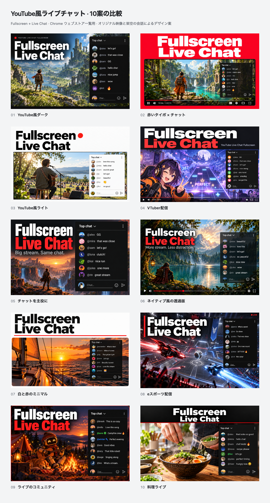

# YouTube-style live chat: ten promo directions

**Ten English-first listing-image concepts**, created on **2026-10-15 (JST)** for YouTube Live Chat Fullscreen. Every image keeps **Fullscreen** as one word and **Live Chat** as the main phrase. No concept is selected or published.



[Open the comparison gallery](index.html) for **440 × 280** and actual **220 × 140** views; click an image for its **880 × 560** version.

## Design direction

The native chat in the repository's [genuine fullscreen capture](../../inputs/en/live-gaming.png) and [transparent capture](../../inputs/en/transparent-live.png) provided a visual reference for:

- A **Top chat** header, small chevron and vertical menu.
- Small circular avatars and muted handles followed by message text **on the same row**.
- Compact conversation rows, occasional emoji and native-style member/moderator color cues.
- A lower composer with a self-avatar, subtle input line, smiley and outlined send control.
- A chat pane visibly over the video, including a transparent treatment.

The scenes, avatars, handles and conversations in these new concepts are original illustrative material. The captured creator, game and actual conversations were not reused as promotional scenes or messages.

| No. | Direction | 440 × 280 PNG |
| --- | --- | --- |
| 01 | Dark YouTube-style product stage | [01](exports/01.png) |
| 02 | Bold red typography / native chat | [02](exports/02.png) |
| 03 | Light-theme editorial | [03](exports/03.png) |
| 04 | Original VTuber stream | [04](exports/04.png) |
| 05 | Chat as the central subject | [05](exports/05.png) |
| 06 | Transparent native-style chat | [06](exports/06.png) |
| 07 | Minimal white / red | [07](exports/07.png) |
| 08 | Original esports stream | [08](exports/08.png) |
| 09 | Live community / native color cues | [09](exports/09.png) |
| 10 | Cooking livestream | [10](exports/10.png) |

04, 08 and 10 give the most specific streaming contexts; 06 makes the transparent overlay particularly clear. 01, 05 and 09 give more space to the conversation to make its anatomy recognizable at thumbnail size. These are creative judgments, not performance measurements.

## Sources and reproduction

- [concepts.json](concepts.json): gallery labels, source sizes and hashes.
- [prompts.md](prompts.md): complete prompts for **built-in image_gen** generation and refinements.
- `metadata/01.json` through `10.json`: briefs, native-UI direction and reference paths.
- `originals/01.png` through `10.png`: unchanged selected outputs.
- [gallery.html](source/gallery.html): responsive comparison layout and image modal.
- [tile.html](source/tile.html) and [render.mjs](source/render.mjs): export and validation.
- [manifest.json](exports/manifest.json): source/output hashes, PNG format, sizes and gallery checks.

Each concept has a **440 × 280** upload candidate, **880 × 560** review copy (`@2x`) and **220 × 140** preview (`-half`). Exports are opaque **24-bit RGB PNGs**; whole originals are fitted uniformly without source cropping or stretching. [Odd-numbered](exports/comparison-odd.png) and [even-numbered](exports/comparison-even.png) sheets supplement the [all-ten comparison](exports/comparison.png).

With Node.js 24 and repository dependencies installed, run from the repository root:

```bash
node docs/store-assets/chrome-web-store/listing-promo/concepts-youtube-chat-20261015/source/render.mjs
```

The renderer requires exactly ten complete concepts, validates the two main-heading terms in metadata, checks the selected source identity and aspect ratio, and verifies the PNG dimensions and opaque RGB format. Correct letters and native-chat anatomy in the actual artwork require visual review; metadata alone is not typography evidence.

## Verification

All ten originals, the full numbered comparison and all ten actual **220 × 140** exports were visually reviewed. Fullscreen and Live Chat are prominent and correctly spelled; header, avatar/inline-message anatomy and composer controls remain recognizable. Tiny fictional chat text is secondary at thumbnail size.

The renderer produced **30 individual RGB PNGs and three comparison sheets**. Source/output hashes, exact dimensions and RGB format are recorded in the manifest. Actual gallery interactions checked half-size view, requested enlarged image, Escape, full-size restoration and a 375 px mobile viewport. The final `yarn verify` passed **963 tests** (799 core/DOM and 164 contracts).

07 was refined to keep the chat visibly over a continuous video surface; its first sidebar-like draft is preserved in `history/07-initial.png` and is not selected by the renderer.

The [previous Fullscreen + Live Chat set](../concepts-fullscreen-live-chat-20261014/README.md), [first ten directions](../concepts-20261014/README.md) and [initial gaming draft](../README.md) remain preserved. The [genuine live-stream screenshot set](../../README.md) remains separate from these design concepts. No product runtime, extension icon, release version or store listing was changed.
