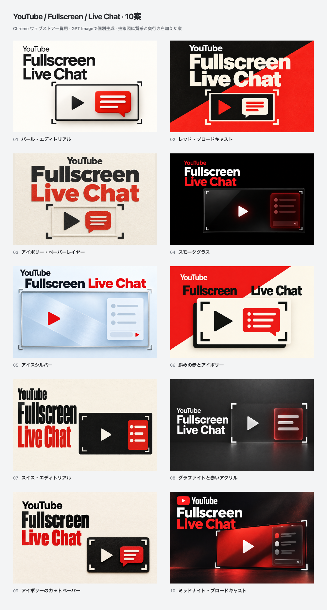

# YouTube / Fullscreen / Live Chat: polished abstract concepts

Ten promotional concepts individually generated with **GPT Image through the built-in `image_gen` tool** on **2026-10-15 (JST)**. The brief keeps the fullscreen-video-and-chat diagram while adding editorial typography, deliberate palettes, material contrast and shallow depth. Every artwork includes **YouTube**, **Fullscreen** and **Live Chat**.



[Open the comparison gallery](index.html) for full-size, **220 × 140** and enlarged views. No concept is selected or published.

| No. | Direction | Upload PNG | Review |
| --- | --- | --- | --- |
| 01 | パール・エディトリアル | [PNG](exports/01.png) | [880 × 560](exports/01@2x.png) |
| 02 | レッド・ブロードキャスト | [PNG](exports/02.png) | [880 × 560](exports/02@2x.png) |
| 03 | アイボリー・ペーパーレイヤー | [PNG](exports/03.png) | [880 × 560](exports/03@2x.png) |
| 04 | スモークグラス | [PNG](exports/04.png) | [880 × 560](exports/04@2x.png) |
| 05 | アイスシルバー | [PNG](exports/05.png) | [880 × 560](exports/05@2x.png) |
| 06 | 斜めの赤とアイボリー | [PNG](exports/06.png) | [880 × 560](exports/06@2x.png) |
| 07 | スイス・エディトリアル | [PNG](exports/07.png) | [880 × 560](exports/07@2x.png) |
| 08 | グラファイトと赤いアクリル | [PNG](exports/08.png) | [880 × 560](exports/08@2x.png) |
| 09 | アイボリーのカットペーパー | [PNG](exports/09.png) | [880 × 560](exports/09@2x.png) |
| 10 | ミッドナイト・ブロードキャスト | [PNG](exports/10.png) | [880 × 560](exports/10@2x.png) |

## Files and reproduction

- `originals/01.png` through `10.png`: chosen generated originals, retained without repainting.
- `metadata/01.json` through `10.json`: concept descriptions, exact generation/revision prompts and provenance.
- [prompts.md](prompts.md): collected prompt set.
- [concepts.json](concepts.json): gallery inventory.
- [source/render.mjs](source/render.mjs), [tile.html](source/tile.html) and [gallery.html](source/gallery.html): repeatable image fitting and interactive comparison.
- [exports/manifest.json](exports/manifest.json): source/output hashes, dimensions, color format and gallery checks.

Each chosen original has a **440 × 280** opaque RGB PNG for store upload, an **880 × 560** review copy (`@2x`) and a **220 × 140** thumbnail (`-half`). The renderer uniformly fits the whole original without cropping, stretching or adding replacement text. Generated proportions may differ by up to 3% from 11:7; a matching matte fills any narrow remainder. Numbered captions appear outside the artworks on comparison sheets.

From the repository root with Node.js 24 and the pinned Yarn dependencies installed:

```bash
node docs/store-assets/chrome-web-store/listing-promo/polished-imagegen-20261015/source/render.mjs
```

This command reproduces exports from the committed originals. Generating replacement artwork requires a fresh image-generation call using the saved prompt; model output is not deterministic.

## Review

The actual saved originals, numbered comparison and all ten **220 × 140** exports were visually inspected. All three required terms appear once in each chosen artwork, with no clipped letters. Chat symbols sit inside the fullscreen video boundary. **02, 01 and 03** are the strongest choices for impact, clarity and restrained texture respectively; this is a creative judgment, not measured store performance. The dark-red chat in 04 has deliberately subdued internal contrast, and 07 uses a more compressed display typeface.

The export checks cover ten complete originals, **33 opaque RGB PNGs**, exact dimensions and source/output hashes. The gallery checks cover the 220 × 140 toggle, enlarged export identity, Escape, full-size restoration and 375 px layout. The final `yarn verify` passed **963 tests** (799 core/DOM and 164 contracts).

These are abstract promotional illustrations, not genuine product screenshots or creator endorsements. The [actual product screenshots](../../README.md) and the [previous vector proposals](../abstract-youtube-20261015/README.md) remain preserved. No extension runtime, product icon or store listing is changed.
