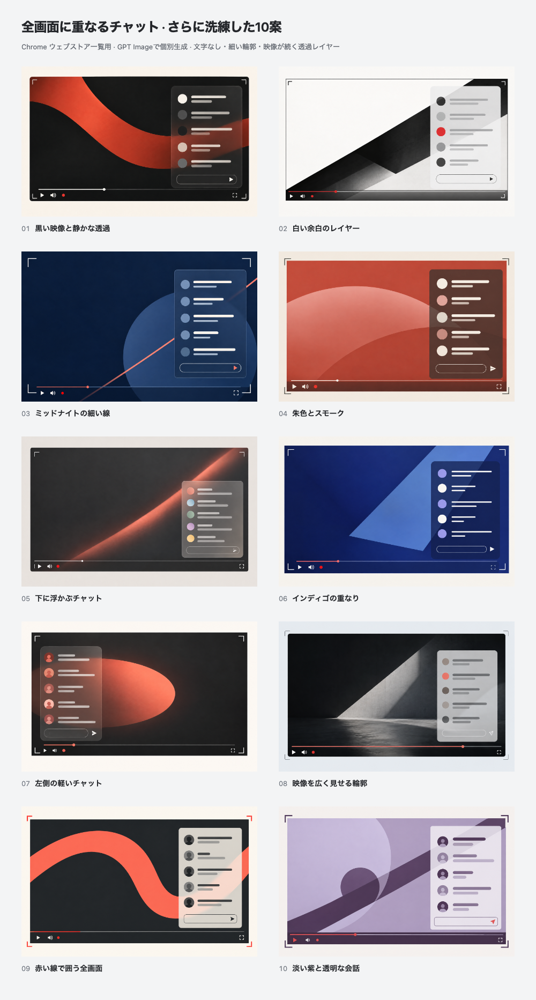

# Refined text-free livestream layouts

Ten additional Chrome Web Store discovery-tile concepts individually generated with **GPT Image through the built-in `image_gen` tool** on **2026-10-15 (JST)**.

The artwork contains **no words, letters, numbers or product name**. All ten place the video play control at the **bottom left**, alongside a speaker symbol and red live-status dot. Chat floats inside the fullscreen picture, above the player controls. Small controls, fine outlines, restrained palettes and translucent layers make the composition closer to watching a YouTube livestream. This is an illustrated layout, not a pixel-accurate screenshot.



[Open the gallery](index.html) to compare **440 × 280** and actual **220 × 140** previews, or click a tile for its **880 × 560** review copy. Gallery numbers and labels are outside the artwork. **06 — インディゴの重なり was selected by the user on 2026-10-16 (JST).** The [selected upload files and selection record](../selected-20261016/README.md) are saved separately; the export manifest retains the original exploration snapshot. No store publication has been performed.

| No. | Direction | Upload PNG | Enlarged |
| --- | --- | --- | --- |
| 01 | 黒い映像と静かな透過 | [PNG](exports/01.png) | [Review](exports/01@2x.png) |
| 02 | 白い余白のレイヤー | [PNG](exports/02.png) | [Review](exports/02@2x.png) |
| 03 | ミッドナイトの細い線 | [PNG](exports/03.png) | [Review](exports/03@2x.png) |
| 04 | 朱色とスモーク | [PNG](exports/04.png) | [Review](exports/04@2x.png) |
| 05 | 下に浮かぶチャット | [PNG](exports/05.png) | [Review](exports/05@2x.png) |
| 06 | インディゴの重なり | [PNG](exports/06.png) | [Review](exports/06@2x.png) |
| 07 | 左側の軽いチャット | [PNG](exports/07.png) | [Review](exports/07@2x.png) |
| 08 | 映像を広く見せる輪郭 | [PNG](exports/08.png) | [Review](exports/08@2x.png) |
| 09 | 赤い線で囲う全画面 | [PNG](exports/09.png) | [Review](exports/09@2x.png) |
| 10 | 淡い紫と透明な会話 | [PNG](exports/10.png) | [Review](exports/10@2x.png) |

## Source and reproduction

- `originals/01.png` through `10.png`: selected native generated images.
- `metadata/01.json` through `10.json`: exact prompts, revisions and provenance.
- [prompts.md](prompts.md): collected exact prompt set.
- [concepts.json](concepts.json): selected inventory.
- [source/render.mjs](source/render.mjs), [tile.html](source/tile.html) and [gallery.html](source/gallery.html): repeatable exports and responsive comparison.
- [exports/manifest.json](exports/manifest.json): selected source/output hashes, dimensions and gallery checks.
- `history/01-initial.png` through `08-initial.png`: preserved drafts before bottom-player-control revisions.

Each original produces an opaque **440 × 280 RGB PNG**, an **880 × 560** review copy and a **220 × 140** preview. Three comparison sheets bring the total to **33 PNG exports**. Complete originals are uniformly fitted without crop, stretching, repainting or added artwork text. Native ratios may differ by up to 3% from 11:7; a matte fills any narrow remainder.

From the repository root with Node.js 24 and pinned dependencies:

```bash
node docs/store-assets/chrome-web-store/listing-promo/refined-text-free-imagegen-20261015/source/render.mjs
```

This reproduces exports from saved originals. New generation requires another image-generation call and is not deterministic.

## Review

All ten selected images, the final comparison sheet and all actual **220 × 140** previews were visually inspected. All use bottom-left playback controls, no central play symbol and chat inside the video boundary, above the controls. Geometric content or lighting continues behind translucent chat. 07 uses left-side chat; 05 uses a smaller lower-right panel. 08 interprets the geometric-video brief as an architectural light-and-shadow scene. Some artwork has generated grain or soft shading.

The graphics use schematic chat sizes and symbols to keep the feature legible in a listing tile. Message strokes represent text without rendering any real messages. These are original promotional illustrations, not genuine product captures or a claim of exact current YouTube UI.

The renderer passed exact sizes, opaque RGB output and gallery checks for half-size comparison, enlarged export identity, Escape, full-size restoration and 375 px layout. Final validation matched **26 selected source hashes** and **33 output hashes**. `yarn verify` passed **963 tests** (799 core/DOM and 164 contracts), with five existing CSS warnings.

The [previous ten text-free diagrams](../text-free-imagegen-20261015/README.md) and linked older explorations remain preserved. [Genuine product screenshots](../../README.md) are documented separately.
