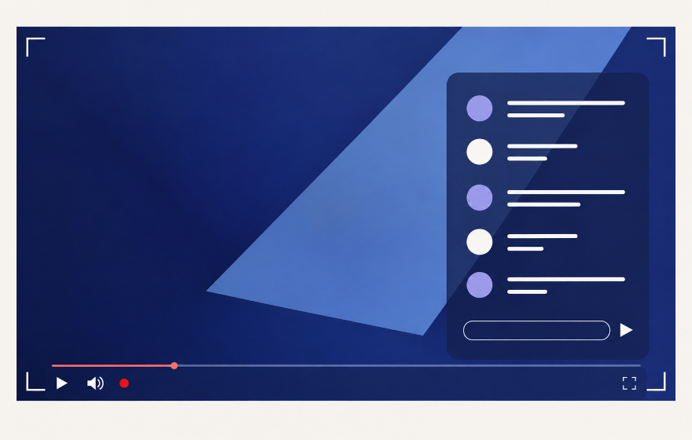

# Selected Chrome Web Store discovery tile

The user selected **06 — インディゴの重なり** on **2026-10-16 (JST)** by attaching the enlarged image. Its decoded pixels match the saved 880 × 560 review export exactly; PNG compression differs.



- **Store upload:** [small-promo.png](small-promo.png), 440 × 280, opaque RGB PNG.
- **Review copy:** [small-promo@2x.png](small-promo@2x.png), 880 × 560, opaque RGB PNG.
- **Selection and hashes:** [selection.json](selection.json).
- **Generated original:** [06.png](../refined-text-free-imagegen-20261015/originals/06.png).
- **Exact generation and revision prompts:** [06.json](../refined-text-free-imagegen-20261015/metadata/06.json).
- **Other concepts:** [comparison gallery](../refined-text-free-imagegen-20261015/index.html).

The artwork remains text-free. Bottom-left player controls and translucent chat inside the fullscreen video follow the approved composition. Both selected files are byte-for-byte copies of the corresponding source exports; no new generation, crop, color adjustment or repainting was performed.

The source set's export manifest records the original exploration snapshot. This dated [selection record](selection.json) owns the later user selection. Previous concepts and the older capture-based promotional tile remain preserved. The store listing has not been updated.

To reproduce the selected copies after regenerating the source set, from this directory:

```bash
cp ../refined-text-free-imagegen-20261015/exports/06.png small-promo.png
cp ../refined-text-free-imagegen-20261015/exports/06@2x.png small-promo@2x.png
```

Both selected PNG dimensions, RGB format, hashes and equality with their source exports were checked. Documentation links and the Git diff were checked. No code or configuration changed in this selection step.
