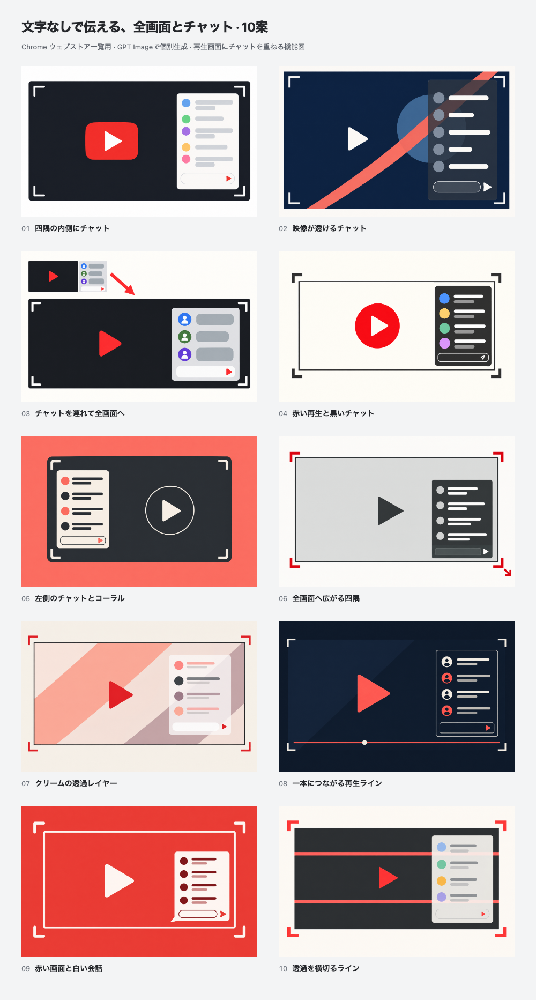

# Text-free fullscreen-chat diagrams

Ten Chrome Web Store discovery-tile concepts individually generated with **GPT Image through the built-in `image_gen` tool** on **2026-10-15 (JST)**. No words, letters, numbers or product name appear inside the artwork. A play symbol, four fullscreen corners and inset chat shapes communicate **fullscreen video with live chat overlaid inside**.



[Open the gallery](index.html) to compare at **440 × 280** or actual **220 × 140**, and click any tile for its **880 × 560** review copy. Numbers and direction names appear outside the artwork in the gallery and comparison sheets. No direction is selected or published.

| No. | Direction | Upload PNG | Enlarged |
| --- | --- | --- | --- |
| 01 | 四隅の内側にチャット | [PNG](exports/01.png) | [Review](exports/01@2x.png) |
| 02 | 映像が透けるチャット | [PNG](exports/02.png) | [Review](exports/02@2x.png) |
| 03 | チャットを連れて全画面へ | [PNG](exports/03.png) | [Review](exports/03@2x.png) |
| 04 | 赤い再生と黒いチャット | [PNG](exports/04.png) | [Review](exports/04@2x.png) |
| 05 | 左側のチャットとコーラル | [PNG](exports/05.png) | [Review](exports/05@2x.png) |
| 06 | 全画面へ広がる四隅 | [PNG](exports/06.png) | [Review](exports/06@2x.png) |
| 07 | クリームの透過レイヤー | [PNG](exports/07.png) | [Review](exports/07@2x.png) |
| 08 | 一本につながる再生ライン | [PNG](exports/08.png) | [Review](exports/08@2x.png) |
| 09 | 赤い画面と白い会話 | [PNG](exports/09.png) | [Review](exports/09@2x.png) |
| 10 | 透過を横切るライン | [PNG](exports/10.png) | [Review](exports/10@2x.png) |

## Source and reproduction

- `originals/01.png` through `10.png`: selected native generated originals.
- `metadata/01.json` through `10.json`: exact generation/revision prompts, concept notes and provenance.
- [prompts.md](prompts.md): collected exact prompt set.
- [concepts.json](concepts.json): selected inventory.
- [source/render.mjs](source/render.mjs), [tile.html](source/tile.html) and [gallery.html](source/gallery.html): repeatable exports and responsive comparison.
- [exports/manifest.json](exports/manifest.json): source/output hashes, dimensions, RGB format and gallery checks.
- [history/04-initial-panoramic.png](history/04-initial-panoramic.png): preserved first draft before aspect-ratio correction.

Each original produces an opaque **440 × 280 RGB PNG**, an **880 × 560** review copy and a **220 × 140** preview. All-concept and odd/even comparison sheets bring the total to **33 PNG exports**. The renderer uniformly fits the complete original without crop, stretching, repainting or added artwork text. Native ratios may differ by up to 3% from 11:7; a matte fills any narrow remainder.

From the repository root with Node.js 24 and pinned Yarn dependencies installed:

```bash
node docs/store-assets/chrome-web-store/listing-promo/text-free-imagegen-20261015/source/render.mjs
```

This reproduces exports from saved originals. New generation requires a fresh image-generation call and is not deterministic.

## Review

All ten selected originals, the final comparison sheet and every actual **220 × 140** preview were visually reviewed, including an independent second pass. No in-image text, clipped symbols or chat outside the main fullscreen boundary were found. 03 shows the normal-to-fullscreen transition; 02, 07 and 10 show geometric video content continuing behind translucent chat. 05 uses left-side chat. 06 has a subtle composer outline, with its input silhouette and send symbol still visible at thumbnail size.

**01, 02 and 09** are strong candidates for immediate YouTube recognition, explicit transparency and bold thumbnail contrast respectively. 03 is useful when explaining the transition matters most. These are design judgments, not measured store performance. Some generated artwork has soft shading; these diagrams use schematic proportions rather than pixel-accurate product UI.

The renderer passed exact dimensions, opaque RGB output and gallery checks for half-size comparison, enlarged export identity, Escape, full-size restoration and 375 px layout. Final validation matched **26 source hashes** and **33 output hashes**. `yarn verify` passed **963 tests** (799 core/DOM and 164 contracts), with five existing CSS warnings.

The [previous twenty name-led concepts](../balanced-name-20-imagegen-20261015/README.md) and older sets remain preserved. [Genuine product screenshots](../../README.md) remain separately documented. These are promotional diagrams; no store publication was performed.
