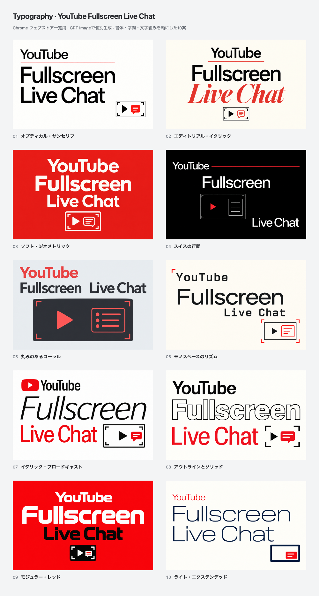

# YouTube / Fullscreen / Live Chat: typography-led concepts

Ten promotional concepts individually generated with **GPT Image through the built-in `image_gen` tool** on **2026-10-15 (JST)**. This round focuses on letterforms, weight, optical spacing, leading and hierarchy: neo-grotesk, serif italic, humanist, monospace, outline and geometric directions. The video/chat diagram supports the typography. Every artwork includes **YouTube**, **Fullscreen** and **Live Chat**.



[Open the comparison gallery](index.html) for full-size, **220 × 140** and enlarged views. No concept is selected or published.

| No. | Direction | Upload PNG | Review |
| --- | --- | --- | --- |
| 01 | オプティカル・サンセリフ | [PNG](exports/01.png) | [880 × 560](exports/01@2x.png) |
| 02 | エディトリアル・イタリック | [PNG](exports/02.png) | [880 × 560](exports/02@2x.png) |
| 03 | ソフト・ジオメトリック | [PNG](exports/03.png) | [880 × 560](exports/03@2x.png) |
| 04 | スイスの行間 | [PNG](exports/04.png) | [880 × 560](exports/04@2x.png) |
| 05 | 丸みのあるコーラル | [PNG](exports/05.png) | [880 × 560](exports/05@2x.png) |
| 06 | モノスペースのリズム | [PNG](exports/06.png) | [880 × 560](exports/06@2x.png) |
| 07 | イタリック・ブロードキャスト | [PNG](exports/07.png) | [880 × 560](exports/07@2x.png) |
| 08 | アウトラインとソリッド | [PNG](exports/08.png) | [880 × 560](exports/08@2x.png) |
| 09 | モジュラー・レッド | [PNG](exports/09.png) | [880 × 560](exports/09@2x.png) |
| 10 | ライト・エクステンデッド | [PNG](exports/10.png) | [880 × 560](exports/10@2x.png) |

## Files and reproduction

- `originals/01.png` through `10.png`: chosen generated originals, retained without repainting.
- `metadata/01.json` through `10.json`: concept descriptions, exact generation/revision prompts and provenance.
- [prompts.md](prompts.md): collected prompt set.
- [concepts.json](concepts.json): gallery inventory.
- [source/render.mjs](source/render.mjs), [tile.html](source/tile.html) and [gallery.html](source/gallery.html): repeatable image fitting and interactive comparison.
- [exports/manifest.json](exports/manifest.json): source/output hashes, dimensions, color format and gallery checks.

Each chosen original has a **440 × 280** opaque RGB PNG for store upload, an **880 × 560** review copy (`@2x`) and a **220 × 140** thumbnail (`-half`). The renderer uniformly fits the whole original without cropping, stretching or adding replacement text. Generated proportions may differ by up to 3% from 11:7; a matching matte fills any narrow remainder. Numbered captions appear outside the artworks on comparison sheets.

From the repository root with Node.js 24 and the pinned Yarn dependencies installed:

```bash
node docs/store-assets/chrome-web-store/listing-promo/typography-imagegen-20261015/source/render.mjs
```

This command reproduces exports from the saved originals. Generating replacement artwork requires a fresh image-generation call using the saved prompt; model output is not deterministic.

## Review

The actual saved originals, comparison and all ten **220 × 140** exports were visually reviewed. Every chosen artwork contains YouTube, Fullscreen and Live Chat once, with no clipped letters. **02, 10 and 04** are the strongest typography directions: serif/sans contrast, light extended lettering and asymmetric Swiss composition. This is a creative judgment rather than measured store performance. The fine diagram in 04 is quieter at thumbnail size, while 10 deliberately uses a small screen/chat symbol.

The export checks cover ten complete originals, **33 opaque RGB PNGs**, exact dimensions and source/output hashes. Gallery checks cover the real 220 × 140 toggle, enlarged export identity, Escape, full-size restoration and 375 px layout. The final `yarn verify` passed **963 tests** (799 core/DOM and 164 contracts).

All in-image lettering is part of the generated bitmap; rendering code only fits and exports the image. Typeface names in prompts describe visual direction, rather than certifying a particular installed font.

These are abstract promotional illustrations, not genuine product screenshots or creator endorsements. The [actual product screenshots](../../README.md), [previous material-led concepts](../polished-imagegen-20261015/README.md) and [vector proposals](../abstract-youtube-20261015/README.md) remain preserved. No extension runtime, product icon or store listing is changed.
