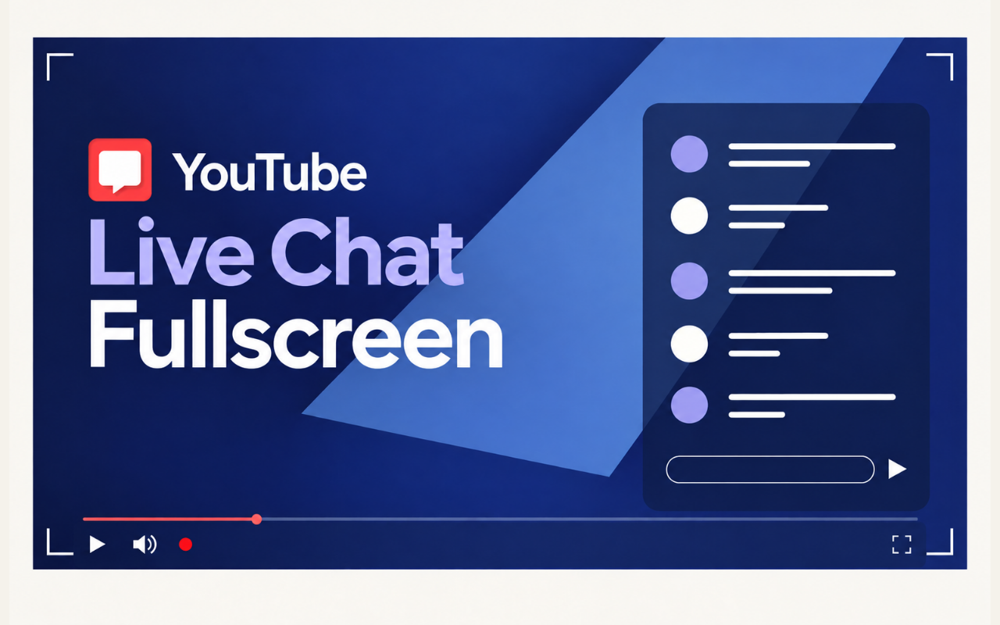
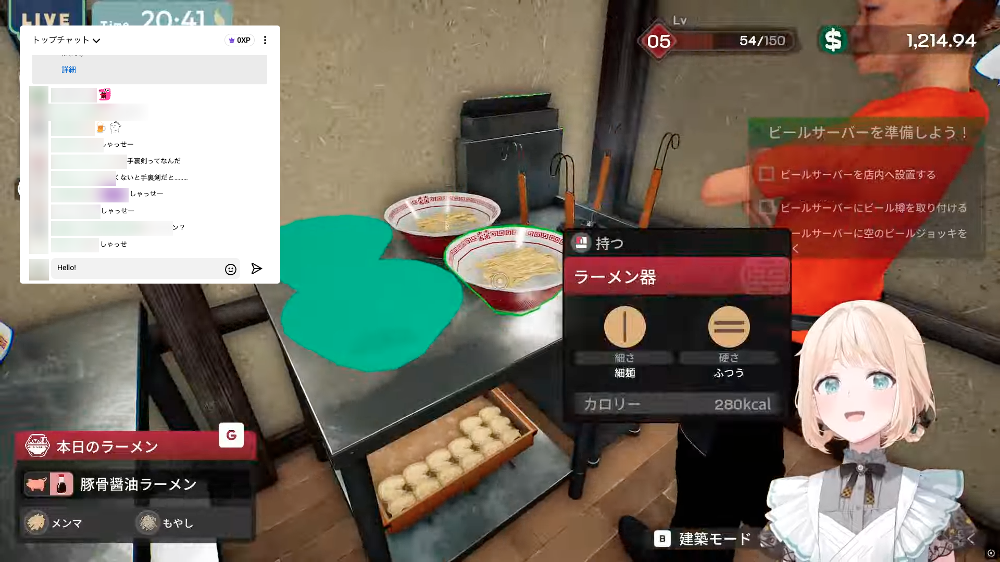
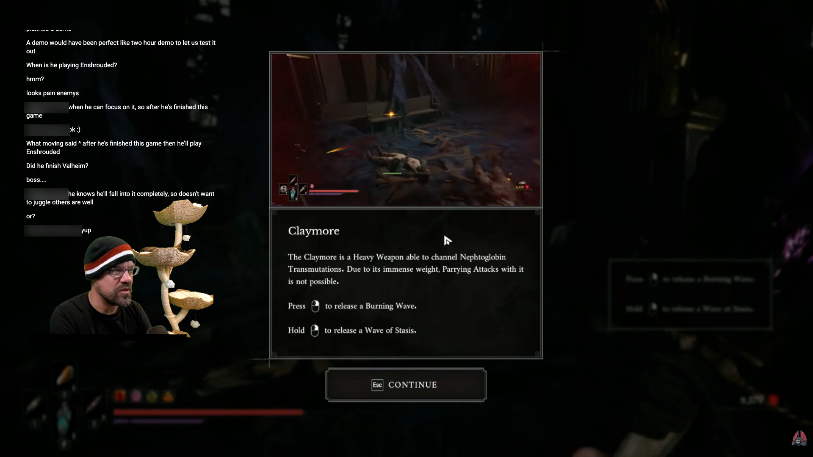
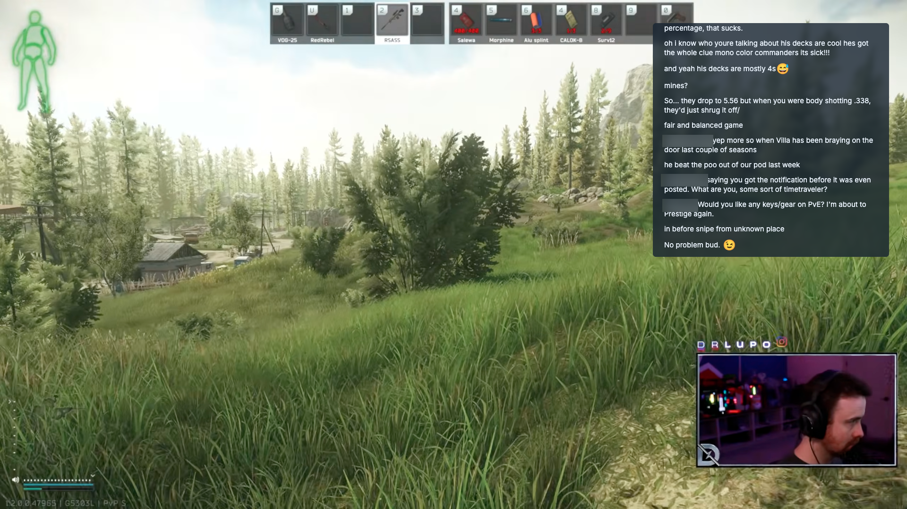

  

  <strong>フルスクリーンでも、映像とチャットを一緒に。</strong> 
  YouTube 本来のチャットをフルスクリーンの動画に重ねます。

  
  

  ライブとリプレイ · 55 ロケール · 無料・オープンソース 
  <a href="user-guide.ja.md">使い方</a> · <a href="../../README.md">English</a> · <strong>日本語</strong> · <a href="README.zh-TW.md">繁體中文</a>

## 好みの見た目を選ぶ

### ライブを見ながら会話にも参加

チャットを読み、YouTube 本来の入力欄で投稿できます。画像の入力途中のメッセージは送信していません。

  
  

**透過スタイル**で映像を見やすく。**カスタムスタイル**で色やフォントを好みに。 
どちらもチャットのみを表示したリプレイの例で、入力欄はありません。各画像を開くと、元の解像度で見られます。

配信映像：風真いろは / hololive、CohhCarnage、DrLupo。画像では視聴者名などをぼかすか非表示にしています。<a href="../store-assets/chrome-web-store/README.md#sources-and-privacy">出典とプライバシー処理（英語）</a>。

## 自分好みに調整

- **移動とサイズ変更**：ゲーム画面や出演者に合わせて配置。
- **色・透明度・ぼかし**：背景、文字、メッセージの間隔を調整。
- **スタイルを保存**：名前付きプリセットを保存し、設定を書き出してバックアップや別のブラウザへの移行に。

ライト、ダーク、システム設定に合わせたテーマと、右から左に読む言語のレイアウトに対応しています。[操作方法を見る →](user-guide.ja.md)

## 3 ステップで使い始める

1. 上のボタンから Chrome ウェブストアか Firefox アドオンを開いて**インストール**。
2. YouTube のライブ配信、またはチャットリプレイを再生できるアーカイブを**フルスクリーンに**。
3. **チャットを配置**。パネルにポインターを重ねると、移動、サイズ変更、設定の操作ができます。

チャット表示は初期状態で有効です。プレイヤーのチャットボタンで表示を切り替えられます。 
[表示されないときは](troubleshooting.ja.md) · [プリセットとバックアップ](user-guide.ja.md)

<strong>チャット・対応ブラウザ・プライバシー</strong>

チャットには YouTube 本来の機能を使います。ログイン、投稿、バッジ、Super Chat は YouTube のルールやチャンネルの参加条件に従います。アーカイブでは、当時のチャットが再生されます。

デスクトップブラウザ向けの拡張機能です。Chrome 版は Opera でも動作します。利用できるチャットがない動画では、通常のフルスクリーンプレイヤーを表示します。

拡張機能用のアカウントやアクセス解析 SDK、トラッキングサービスはありません。設定はこのブラウザの `browser.storage.local` に保存され、閲覧履歴やチャット本文を開発者へ送信しません。YouTube 本来のチャットは、引き続き YouTube と通信します。選択した追加フォントは Google Fonts から取得する場合があります。

配布版が要求する権限は `storage` のみです。ページ上で動くスクリプトや、ページから利用できる拡張機能のリソースは YouTube に限定しています。[権限とリソースの設定](../../config/packagePolicy.ts)と[パッケージの検証コード](../../scripts/verify/check-package-contracts.mjs)で確認できます。

<strong>実装を知る</strong>

WXT、React、TypeScript、Jotai、Tailwind CSS を使った Chrome / Firefox 向けの拡張機能です。以下の開発資料は英語です。

- [コンテンツの実行処理](../architecture/content-runtime.md)：YouTube のページ遷移に合わせて表示を更新し、借りたチャット iframe を元に戻します。
- [設定と状態](../architecture/settings-and-state.md)：編集中の値、保存済みの設定、別の拡張画面からの変更を順序どおりに扱いながらプレビューします。
- [ブラウザテスト](../testing/contracts.md)：同じ条件のテスト用ページでライブ、リプレイ、チャットなしを再現し、実際のサイトとの互換性は別に確認します。

[技術概要](../engineering.md)や[貢献の始め方](../../CONTRIBUTING.md#choose-a-starting-point)からご覧ください。

## 改善に参加する

[不具合を報告する](https://github.com/daichan132/Youtube-Live-Chat-Fullscreen/issues/new?template=bug.yml) · [機能を提案する](https://github.com/daichan132/Youtube-Live-Chat-Fullscreen/issues/new?template=feature.yml) · [翻訳やガイドを改善する](../../CONTRIBUTING.md)

脆弱性の非公開報告：<a href="../../SECURITY.md">SECURITY.md（英語）</a> · <a href="../../LICENSE">GPL-3.0</a> ライセンス。
