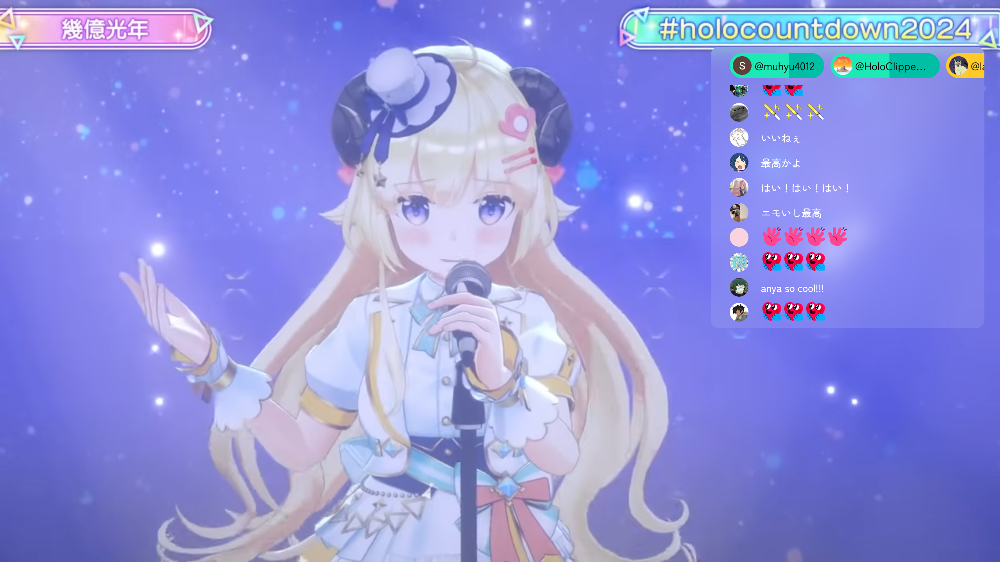

<div align="center">
  
</div>

<h1 align="center">YouTube Live Chat Fullscreen</h1>

<p align="center">
  <strong>全螢幕看影片，也看得見聊天室。</strong><br />
  把 YouTube 聊天室放到影片上，自由移動、調整大小，打造適合自己的觀看畫面。
</p>

<p align="center">
  Chrome &amp; Firefox · 直播與重播 · 55 個介面語系 · 免費開源
</p>

<p align="center">
  <a href="https://chromewebstore.google.com/detail/youtube-live-chat-fullscr/dlnjcbkmomenmieechnmgglgcljhoepd"><strong>安裝到 Chrome</strong></a>
  ·
  <a href="https://addons.mozilla.org/zh-TW/firefox/addon/youtube-live-chat-fullscreen/"><strong>安裝到 Firefox</strong></a>
  ·
  <a href="../user-guide.md">使用指南（英文）</a>
  ·
  <a href="../../README.md">English</a>
  ·
  <a href="README.ja.md">日本語</a>
  ·
  <strong>繁體中文</strong>
</p>



*這是使用透明背景、隱藏一般訊息使用者名稱的版面範例。依照直播畫面，選擇合適的顏色、字級與位置。*

## 看影片，也跟上聊天

看演唱會、追遊戲直播，或補看直播存檔時，都能同時看到聊天室的反應。覆蓋視窗使用 YouTube 原本的聊天室，因此直播聊天的登入、留言、徽章與 Super Chat 仍由 YouTube 處理。

| 留空間給影片 | 讓聊天更好讀 |
| --- | --- |
| 拖曳視窗，移到較不遮擋畫面的位置 | 調整字級、字型、顏色與訊息間距 |
| 從邊緣或角落調整大小 | 選擇背景透明度與模糊效果 |
| 播放器控制列隱藏後，繼續顯示聊天 | 隱藏一般訊息的使用者名稱與頭像 |
| 使用「僅顯示聊天室」，讓版面更精簡 | 為樣式取名並儲存，方便切換 |

提供亮色、暗色與跟隨系統的主題，以及 55 個介面語系和由右至左的版面。設定可以匯出成 JSON，方便備份或手動移到另一個瀏覽器。

## 開始觀看

1. 從 [Chrome 線上應用程式商店](https://chromewebstore.google.com/detail/youtube-live-chat-fullscr/dlnjcbkmomenmieechnmgglgcljhoepd) 或 [Firefox 附加元件](https://addons.mozilla.org/zh-TW/firefox/addon/youtube-live-chat-fullscreen/) 安裝。
2. 開啟 YouTube 直播，或聊天重播可播放的直播存檔，然後進入全螢幕。聊天顯示預設為開啟。
3. 將游標移到聊天視窗上即可顯示控制按鈕。拖曳來移動、從邊緣調整大小，或開啟設定來更改外觀。播放器的聊天按鈕可以切換顯示與隱藏。

本擴充功能適用於桌面瀏覽器，Chrome 版也能在 Opera 上執行。沒有可用聊天的影片，會保留一般的全螢幕播放器畫面。

預設樣式與備份的操作請看[使用指南](../user-guide.md)；聊天視窗沒有出現時，請看[疑難排解](../troubleshooting.md)（兩者皆為英文）。

## 查得到的隱私設計

擴充功能不需要額外帳號，也沒有分析 SDK 或追蹤服務。設定保存在此瀏覽器的 `browser.storage.local`，擴充功能不會把觀看活動或聊天內容傳送給開發者。YouTube 原本的聊天室仍會與 YouTube 通訊。

正式版 manifest 只要求 `storage` 權限，content script 與公開的擴充功能資源也都限定在 YouTube 使用。選擇額外字型時，可能會從 Google Fonts 下載。這些範圍可以在 [package policy](../../config/packagePolicy.ts) 與 [package checks](../../scripts/verify/check-package-contracts.mjs) 中確認。

## 探索程式碼

本專案使用 WXT、React、TypeScript、Jotai 與 Tailwind CSS，以同一份程式碼建置 Chrome 和 Firefox 版本。開發的重點，是讓全螢幕聊天視窗能在持續變動的 YouTube 頁面上穩定運作：

- **YouTube 生命週期**：處理 SPA 導覽、播放器替換、直播與重播切換，以及借用聊天 iframe 後的還原。
- **不同介面共用的設定**：彈出視窗、覆蓋視窗與設定頁面共用已儲存的偏好，避免無關的修改互相覆寫。
- **瀏覽器驗證**：包含確定性的 YouTube fixture、視覺與無障礙檢查、正式版 package 契約，以及獨立的實際 YouTube 相容性檢查。

[工程概覽](../engineering.md)提供程式碼導覽；想深入特定領域，可從[文件索引](../README.md)開始（英文）。

### 在本機執行

使用 Node.js 24，以及 `package.json` 的 `packageManager` 所指定的 Yarn 版本。

```bash
corepack enable
yarn install --immutable
yarn dev              # Chrome；Firefox 請用 yarn dev:firefox
```

修改程式碼、設定或依賴套件後，請完成本機品質檢查：

```bash
yarn verify
```

安裝步驟、瀏覽器測試的事前準備，以及 package 和發布的額外檢查，請看 [CONTRIBUTING.md](../../CONTRIBUTING.md) 與[測試契約](../testing/contracts.md)（英文）。

## 一起改善擴充功能

歡迎回報問題、翻譯文件、改善說明，或提交範圍明確的修正。讓聊天更容易閱讀的小改動，或能重現 YouTube 相容性問題的操作步驟，都能幫助下一位使用者。

- [回報問題](https://github.com/daichan132/Youtube-Live-Chat-Fullscreen/issues/new?template=bug.yml)，或[提出功能建議](https://github.com/daichan132/Youtube-Live-Chat-Fullscreen/issues/new?template=feature.yml)。
- 第一次修改前，請閱讀[貢獻指南](../../CONTRIBUTING.md)（英文）。
- 安全性漏洞請依 [SECURITY.md](../../SECURITY.md) 的非公開流程回報。

採用 [GPL-3.0](../../LICENSE) 授權。
