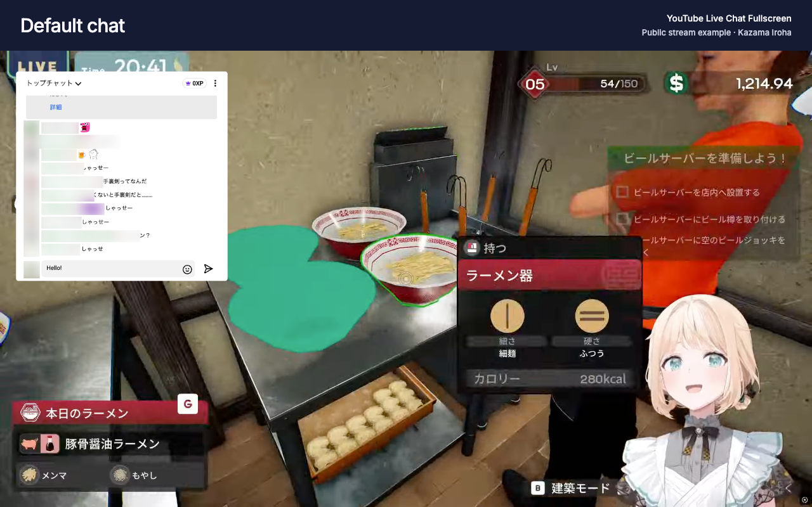

[English](../user-guide.md) · [日本語](user-guide.ja.md) · **繁體中文**

# 在全螢幕中觀看與聊天

YouTube Live Chat Fullscreen 會將 YouTube 的聊天室疊在影片上。本指南介紹日常操作；安裝連結與版面範例請見[產品介紹](README.zh-TW.md)。

## 開啟聊天視窗

1. 從 [Chrome 線上應用程式商店](https://chromewebstore.google.com/detail/youtube-live-chat-fullscr/dlnjcbkmomenmieechnmgglgcljhoepd)或 [Firefox 附加元件](https://addons.mozilla.org/firefox/addon/youtube-live-chat-fullscreen/)安裝擴充功能。
2. 開啟直播，或具有可播放聊天重播的直播存檔。
3. 使用 YouTube 播放器的全螢幕按鈕進入全螢幕。聊天室預設為開啟；播放器控制列中的聊天按鈕可將它關閉或開啟。

若先前停用了擴充功能，可從瀏覽器工具列開啟擴充功能的彈出視窗，再次啟用。彈出視窗也提供「淺色」、「深色」與跟隨系統的「自動」主題，以及介面語言選單。

聊天室仍由 YouTube 提供。登入與直播留言遵循 YouTube 原本的規則；擴充功能不需要額外帳號。存檔中的聊天內容是原對話的重播。

*標準聊天室與原生輸入欄的範例，輸入中的訊息尚未送出。截圖中的觀眾身分已模糊處理。直播影像：Kazama Iroha / hololive。[來源與隱私處理（英文）](../store-assets/chrome-web-store/README.md#sources-and-privacy)。*

## 調整聊天視窗的位置與大小

將游標移到聊天視窗上，即可顯示控制按鈕。拖曳點狀把手可移動視窗，拖曳邊緣或角落可調整大小。較窄的視窗能為主要畫面留出更多空間；較寬的視窗則為較長的訊息留出換行空間。

選取水平箭頭按鈕 **Adjust position and size**，即可逐步移動視窗或調整寬度與高度。這個按鈕的介面文字目前為英文，意思是「調整位置與大小」。也可使用 Tab 鍵移至控制列，再以鍵盤操作這些按鈕。

儲存的版面以播放器為基準，因此能配合不同的全螢幕尺寸調整。自動配置也能讓聊天視窗避開字幕或播放器控制列。手動調整版面後，會優先採用手動設定。

## 調整閱讀樣式

選取聊天視窗控制列中的滑桿圖示按鈕「**開啟設定**」，即可更改閱讀樣式。

完成調整後，外觀與位置變更會自動儲存。

| 設定 | 用途 |
| --- | --- |
| 字型大小與字型 | 配合觀看距離，調整到舒適的大小與字型 |
| 字型顏色與會員名稱顏色 | 讓訊息在背景上保持清晰 |
| 背景顏色、透明度與模糊效果 | 讓聊天內容與繁忙的影片畫面有所區隔 |
| 間距 | 增加訊息之間的留白 |
| 顯示使用者名稱與顯示使用者頭像 | 簡化一般訊息；付費訊息的身分資訊仍會顯示 |
| 閒置時顯示聊天室 | 播放器控制列淡出後，仍保持聊天室可見 |
| 僅顯示聊天室 | 將聊天室標頭與輸入欄收起，游標移入時再顯示 |

若要像產品介紹中的範例一樣讓背景完全透明，請開啟「**背景顏色**」，將底部的透明度滑桿拉到最左端（0%），並將「**模糊效果**」設為 **0**。若要只顯示訊息，請先開啟「**閒置時顯示聊天室**」，再開啟「**僅顯示聊天室**」。若希望訊息輸入欄持續顯示，請保持「僅顯示聊天室」關閉。較舊的電腦若操作變慢，可降低模糊效果。

設定控制項具有無障礙標籤，並支援鍵盤操作。從視窗邊緣拖曳與調整大小需要指標裝置；也可改用位置調整按鈕。

## 儲存預設方案

開啟「**預設方案**」分頁，在想使用的樣式上選取「**套用**」。可先試用下列內建樣式。

- 「**透明**」使用半透明背景與模糊效果。
- 「**大字**」使用較大的文字與淺色背景。
- 「**僅聊天室**」隱藏一般訊息的名稱與頭像，並將標頭與輸入欄收起，游標移入時再顯示。

若要將目前樣式另存為具名方案，請選取「**新增目前設定**」，再將新方案的名稱從「**未命名**」改為容易辨識的名稱。這樣就能準備好緊湊的遊戲版面與較寬鬆的閱讀樣式，隨時切換。

預設方案會儲存外觀與顯示選項，包括閒置時的顯示方式及僅顯示訊息的模式。視窗的位置與大小會另外儲存，因此套用另一個方案不會移動視窗。

## 備份或移轉設定

從瀏覽器工具列開啟擴充功能的彈出視窗，將設定匯出為 JSON 檔案。若要移轉到另一個瀏覽器或使用者設定檔，請在匯入控制項中選擇檔案，確認預覽內容，再選取 **Apply**。這個匯入按鈕目前以英文顯示，意思是「套用」。

備份包含擴充功能的啟用狀態、主題、外觀、具名預設方案，以及視窗的位置與大小。介面語言是各瀏覽器本機的偏好設定，不會包含在備份中。設定儲存在本機，不會透過帳號自動同步。

匯入會以備份內容取代對應設定；若想保留目前設定，請先匯出一份副本。

## 聊天室無法使用時

一般影片及沒有可用聊天室的直播，不會顯示全螢幕聊天視窗。直播存檔必須有可用且能播放的 YouTube 聊天重播，擴充功能才能顯示。擴充功能無法新增 YouTube 未提供的對話。

若 YouTube 的聊天室可用，但聊天視窗沒有出現，或版面停止回應，請依照[疑難排解](troubleshooting.zh-TW.md)檢查。

## 隱私

設定保存在此瀏覽器中。擴充功能沒有分析或追蹤服務，也不會將聊天內容或觀看活動傳送給開發者。YouTube 的聊天室使用 YouTube 自己的服務，額外字型則可能從 Google Fonts 載入。

[返回產品介紹](README.zh-TW.md) · [瀏覽文件（英文）](../README.md)
